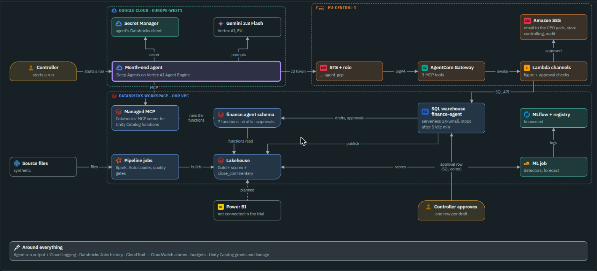

# 🛒 Retail Finance Data, ML and Agentic AI Platform · Control plane

> 🎛️ **This repo is the control plane:** status, architecture, decisions, stories and security docs, plus the web app. No infrastructure or pipeline code lives here.
>
> | Repo | Owns |
> |---|---|
> | 🎛️ **retail-finance-platform-control-plane** (this one) | Status, architecture, stories, decisions (`cmdb.yml`), the web app in `site/` |
> | 🏗️ [retail-finance-platform-infra](https://github.com/kheuchi/retail-finance-platform-infra) | Terraform: AWS foundation, network, Databricks workspace, agent on Google Cloud, guardrails |
> | 📦 [retail-finance-data-products](https://github.com/kheuchi/retail-finance-data-products) | Data generator, Bronze/Silver/Gold jobs, ML models, the month-end agent, tests |
>
> More: [REPOSITORIES.md](REPOSITORIES.md).

**Contents:** [Repos](#-retail-finance-data-ml-and-agentic-ai-platform--control-plane) · [Web app](#-open-the-interactive-web-app) · [TL;DR](#tldr) · [Architecture](#-architecture) · [Where we are](#-where-we-are) · [Start here](#-start-here)

> ## 👉 [Open the interactive web app](https://kheuchi.github.io/retail-finance-platform-control-plane/)
>
> The fastest way in: the whole project in pictures you can click, with a **Simple mode** that explains every box in plain words.
>
> | 🧭 Go to | What you get |
> |---|---|
> | [🏗️ Architecture: as built](https://kheuchi.github.io/retail-finance-platform-control-plane/architecture/architecture.html#built-hld) | What runs today; press Play to follow one month-end, step by step |
> | [🎯 Architecture: enterprise target](https://kheuchi.github.io/retail-finance-platform-control-plane/architecture/architecture.html#target-hld) | What a large grocer would build next |
> | [🗺️ Platform landscape](https://kheuchi.github.io/retail-finance-platform-control-plane/landscape/platform-landscape.html) | Every capability: built, partly, missing |
> | [🧰 Tool scorecard](https://kheuchi.github.io/retail-finance-platform-control-plane/landscape/tools.html) | Our pick vs competitors, per category |

## TL;DR

| Question | Answer |
|---|---|
| 🤔 What is it? | An enterprise-style portfolio project on **AWS + Databricks** for the accounting team of a large (fictional) retailer |
| 🧩 What does it do? | Governed finance data → fraud and forecast models → an AI agent that drafts the month-end commentary for a person to approve |
| 🛑 What does the AI never do? | Post entries, move money, approve payments, or send anything without a human yes |
| 📍 Where are we? | All 7 stages done; see [STATUS.md](STATUS.md) |

## 🧱 Architecture

> **TL;DR:** click the picture for the interactive version. Detail: [`cmdb.yml`](cmdb.yml) → `architecture`

The picture is a screenshot of the web app. The written design is in the [HLD](docs/architecture/hld.md),
which links to the six LLDs (network, identity & CI/CD, data platform, observability & cost, ML, agent).

## 📍 Where we are

> **TL;DR:** built, proven, paying parts switched off. Detail: [STATUS.md](STATUS.md), [`cmdb.yml`](cmdb.yml) → `phases`

- ✅ **Done:** all 7 stages: secure AWS foundation, private Databricks lakehouse, certified Gold, fraud and forecast models with drift checks, and the month-end agent (on Google Agent Runtime + Gemini, D-032).
- 🟡 **Open:** releases (6.3) and monitoring (6.4).
- 💤 **Cost:** paying network parts switched off on 2026-10-17; full teardown only with the owner's go.

## 📚 Start here

> **TL;DR:** the key files, in reading order.

| File | What it is |
|---|---|
| [STATUS.md](STATUS.md) | Status and roadmap: where we are, where we go |
| [AGENTS.md](AGENTS.md) | Rules and way of working, for any AI assistant or new contributor |
| [🗂️ docs/README.md](docs/README.md) | **Map of every doc**, folder by folder |
| [docs/conception/](docs/conception/business-case.md) | **Day 0**: business case and end-to-end workflow, stakeholders (RACI), platform benchmark, ADRs |
| [docs/architecture/](docs/architecture/hld.md) | **As built**: HLD + 6 LLDs (screenshots of the web app, linked) |
| [docs/target/](docs/target/reference-architecture.md) | **Enterprise target** (not built): reference architecture, evaluation and observability |
| [🌐 Web app](https://kheuchi.github.io/retail-finance-platform-control-plane/) | Interactive landscape and architecture (as built and enterprise target); source in `site/` |
| [docs/guides/MEMO.md](docs/guides/MEMO.md) | **One page**: what we built, the tricky parts, the top 10 lessons · deeper: [WALKTHROUGH](docs/guides/WALKTHROUGH.md) |
| [☁️ Cloud equivalents](docs/guides/cloud-equivalents.md) | Every component of this stack and its counterpart on AWS, Azure and Google Cloud |
| [Databricks primer](docs/guides/databricks-primer.md) | Every Databricks term used here, in plain words |
| [docs/stories/](docs/stories/README.md) | History: how each piece was built, what went wrong, the lessons |
| [docs/security/](docs/security/) | Threat model, controls, who owns what |
| [REPOSITORIES.md](REPOSITORIES.md) | Which repo does what |
| [cmdb.yml](cmdb.yml) | Inventory: decisions, risks, threats, controls, stories index, history |

This repo holds coordination and evidence only. Infrastructure code lives in
[retail-finance-platform-infra](https://github.com/kheuchi/retail-finance-platform-infra).
