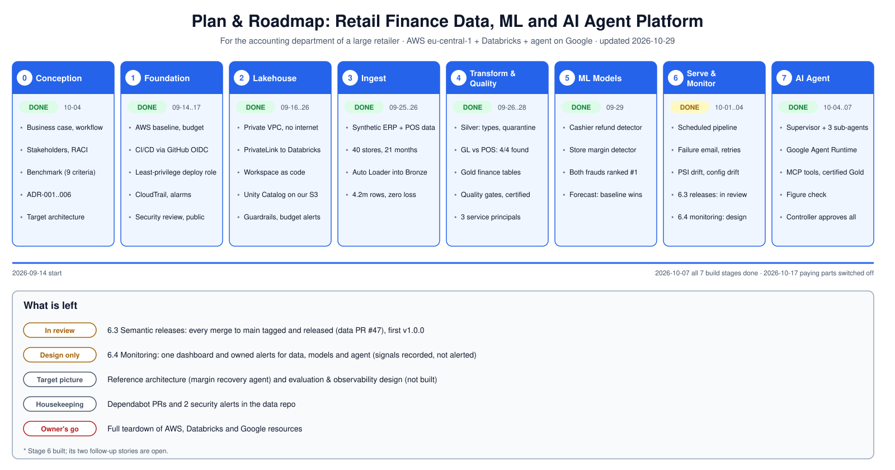

# Status and roadmap

**Contents:** [TL;DR](#tldr) · [Roadmap](#roadmap) · [Where we are](#where-we-are) · [Where we go](#where-we-go) · [Use cases](#use-cases) · [Deadlines and cost](#deadlines-and-cost) · [Open risks](#open-risks) · [Scope rule](#scope-rule)

Updated 2026-11-03 (dates and cost after the trial; docs reorganised, map in [docs/README.md](docs/README.md)). Detail: [`cmdb.yml`](cmdb.yml) → `phases`, `progress`. Architecture: [HLD](docs/architecture/hld.md). How we built it: [stories](docs/stories/README.md). Rules for assistants: [AGENTS.md](AGENTS.md).

> 🌐 **See it working:** the [interactive web app](https://kheuchi.github.io/retail-finance-platform-control-plane/) shows the platform box by box; in Simple mode, press Play to follow one month-end.

## TL;DR

| Question | Answer |
|---|---|
| 🎯 Goal | Show how a large retailer's accounting department could run governed finance data, ML and an AI agent on AWS + Databricks, built the enterprise way |
| 🧩 The plan in one line | Raw ERP and POS data → governed lakehouse → finance models → an agent that drafts cited commentary for the controller to approve |
| 🛑 Agent boundary | May investigate, summarise, recommend. Never posts entries, moves money or approves payments: a human signs off |
| 📍 Where are we? | All 7 stages done (agent on Google Agent Runtime while AWS holds Bedrock, D-032): governed data, reconciliation 4/4, certified Gold, least-privilege identities, fraud models, scheduled pipeline with drift checks |
| ⏭️ What is next? | Final review. Paying parts switched off on 2026-10-17 (VPC endpoints); nothing else destroyed. Full teardown only with the owner's go |
| ⏰ Dates | Databricks trial ended 2026-10-06 (now pay as you go, idle); paying network parts deleted 2026-10-17 |
| 💶 Running cost | ~USD 1-2/month on AWS (secrets, S3, logs); Databricks and Google bill only when something runs |

## Roadmap

## Where we are

> **TL;DR:** all 7 build stages done; follow-ups 6.3 (releases, in review) and 6.4 (monitoring, design only) open; docs site rebuilt on Astro + Svelte ([X.2](docs/stories/X.2-docs-site-v2.md)), live. Detail: [`cmdb.yml`](cmdb.yml) → `phases`, `progress`, `stories`

| # | Stage | Status | Done when | Stories |
|---|---|---|---|---|
| 0 | Conception | ✅ Done | Business case and workflow, stakeholders, benchmark, ADRs | [docs/conception/](docs/conception/business-case.md) |
| 1 | Foundation | ✅ Done | Terraform, CI/CD, audit trail, security alarms, budget in place | [1.1-1.5](docs/stories/README.md#epic-1--foundation) |
| 2 | Lakehouse | ✅ Done | Private Databricks workspace, no internet, Unity Catalog on our S3 | [2.1-2.5](docs/stories/README.md#epic-2--lakehouse) |
| 3 | Ingest | ✅ Done | 40 stores, 21 months of synthetic data in Bronze: 4.2m rows, zero loss | [3.1-3.3](docs/stories/README.md#epic-3--ingest) |
| 4 | Transform & Quality | ✅ Done | Gold finance tables reconcile to controlled inputs | [4.1](docs/stories/4.1-silver-tables.md) ✅, [4.2](docs/stories/4.2-gl-pos-reconciliation.md) ✅, [4.3](docs/stories/4.3-gold-finance-tables.md) ✅, [4.4](docs/stories/4.4-quality-and-lineage.md) ✅, [4.5](docs/stories/4.5-split-service-principals.md) ✅ |
| 5 | ML Models | ✅ Done | Refund fraud, margin leakage and forecast models tracked in MLflow | [5.1](docs/stories/5.1-fraud-detection.md) ✅, [5.2](docs/stories/5.2-revenue-forecast.md) ✅ |
| 6 | Serve & Monitor | ✅ Done | Models score on a schedule, with drift checks | [6.1](docs/stories/6.1-scheduled-pipeline.md), [6.2](docs/stories/6.2-drift-checks.md); [6.3](docs/stories/6.3-semantic-releases.md) 🟡, [6.4](docs/stories/6.4-monitoring.md) design only |
| 7 | AI Agent | ✅ Done | Cited variance commentary; no action without human approval | [7.1](docs/stories/7.1-month-end-agent.md) |

## Where we go

> **TL;DR:** reconciliation, then Gold, then models and the agent reading Gold only.
> What the layers mean: [LLD 3 · Bronze, Silver, Gold](docs/architecture/lld-data-platform.md#bronze-silver-gold).
> Acceptance criteria: stories [4.1](docs/stories/4.1-silver-tables.md) · [4.2](docs/stories/4.2-gl-pos-reconciliation.md) · [4.3](docs/stories/4.3-gold-finance-tables.md) · [4.4](docs/stories/4.4-quality-and-lineage.md)

1. ~~**Silver:** real types, bad rows set aside, nothing lost~~ ✅ done 2026-09-27.
2. ~~**Reconciliation:** the general ledger matches the sales~~ ✅ done 2026-09-27: 4/4 fake journals, 0 false alarms.
3. ~~**Gold:** daily revenue, margin, refunds, actual vs budget~~ ✅ done 2026-09-27.
4. ~~**Models, then the agent,** reading Gold only~~ ✅ done 2026-10-07.
5. **Final review**, then teardown when the owner says go ([runbook](https://github.com/kheuchi/retail-finance-platform-infra/blob/main/docs/runbooks/teardown.md)).

## Use cases

> **TL;DR:** two jobs the accounting team cares about. Detail: [`cmdb.yml`](cmdb.yml) → `program.needs`

| Use case | What it gives finance |
|---|---|
| Refund & margin leakage | Unusual refunds and margin erosion, by store and cashier |
| Month-end close | Revenue and cash forecast, variance vs budget explained |

## Deadlines and cost

> **TL;DR:** the trial is over; almost nothing runs, so almost nothing bills. Detail: [`cmdb.yml`](cmdb.yml) → `program.cloud`, `progress`

| Item | Value |
|---|---|
| Databricks trial | Ended 2026-10-06; the workspace stays, billed per use through AWS Marketplace (USD 8.40 to 2026-10-17) |
| Private network | Interface endpoints deleted 2026-10-17 (were USD 6.34/day); clusters and the AWS agent path need them back (switch on, apply) |
| AWS today | ~USD 1-2/month (secrets, S3, logs); bill to 2026-10-17 USD 106.30 gross, covered by credits |
| Google Cloud | Agent Engine scales to zero; EUR 0.63 gross to 2026-10-17 |
| Teardown | Only with the owner's go ([runbook](https://github.com/kheuchi/retail-finance-platform-infra/blob/main/docs/runbooks/teardown.md)) |

## Open risks

> **TL;DR:** four that matter now. Detail: [`cmdb.yml`](cmdb.yml) → `risks`, `findings`

| Risk | State |
|---|---|
| GitHub 2FA off | Accepted (owner decision) |
| Databricks secret had a ~2026-10-08 expiry (14-day lifetime) | Rotate, or move to OIDC federation, before the next deploy |
| No alarm on audit-trail tampering or IAM changes (F-3) | Open |
| Employee-level fraud scores readable by analysts | Accepted (R-12): pseudonymous, synthetic; production would restrict |

## Scope rule

> **TL;DR:** cut features, never controls. Detail: [`cmdb.yml`](cmdb.yml) → `rules`

If time runs short, keep one thin end-to-end slice working and drop extra datasets or
models, never the security, lineage or teardown.

