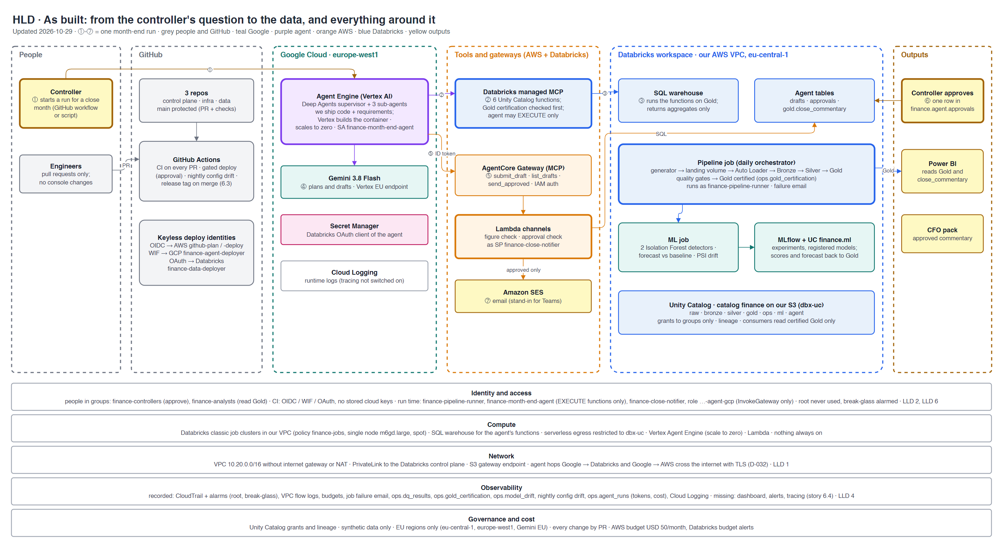

# High-Level Design

**Contents:** [TL;DR](#tldr) · [Diagram](#diagram) · [The six columns and five bands](#the-six-columns-and-five-bands) · [One run, step by step](#one-run-step-by-step) · [Key flows](#key-flows) · [Design choices](#design-choices) · [Zoom in (LLDs)](#zoom-in-llds) · [Edit the diagram](#edit-the-diagram)

Updated 2026-10-29. Why it exists and the end-to-end business workflow: [business case](../conception/business-case.md); decisions: [ADRs](../conception/adr/README.md). Detail: [`cmdb.yml`](../../cmdb.yml) → `architecture`, `decisions`. How it was built: [stories](../stories/README.md).

## TL;DR

| Question | Answer |
|---|---|
| What is it? | A finance data, ML and AI agent platform for the accounting team of a large retailer |
| Where does it run? | AWS eu-central-1 (our account) + Databricks Enterprise (control plane) |
| Where is the finance data? | Only in our S3 buckets. Databricks sends commands, not data |
| How do clusters reach Databricks? | PrivateLink. The VPC has no internet gateway and no NAT |
| Who changes it? | Only CI/CD, through pull requests. No stored cloud keys |
| What is live? | Private workspace, Bronze → Silver → Gold, reconciliation, quality gates, fraud models, forecast, drift checks, month-end agents |
| Where does the agent run? | Designed for AgentCore + Claude on Bedrock; runs on Google Agent Runtime + Gemini (EU) while AWS holds Bedrock ([ADR-006](../conception/adr/ADR-006-agent-platform.md), D-032) |

## Diagram

Interactive versions: [architecture, as built and target](https://kheuchi.github.io/retail-finance-platform-control-plane/architecture/architecture.html) and [landscape](https://kheuchi.github.io/retail-finance-platform-control-plane/landscape/platform-landscape.html). The image below is frozen (draw.io, [diagram rules](../../AGENTS.md#how-we-work)).

## The six columns and five bands

> **TL;DR:** read left to right for one run; read the bands for what surrounds every run.

| Column | Holds | Detail |
|---|---|---|
| **People** | The controller (starts a run), engineers (PRs only) | [stakeholders](../conception/stakeholders.md) |
| **GitHub** | 3 repos, Actions (CI, gated deploy, drift, release), keyless deploy identities | [LLD 2](lld-identity-cicd.md) |
| **Google Cloud** | Agent Engine (Deep Agents, scale to zero), Gemini EU, Secret Manager, Cloud Logging | [LLD 6](lld-agent.md) |
| **Tools and gateways** | Databricks managed MCP (read), AgentCore Gateway → Lambda → SES (send) | [LLD 6](lld-agent.md) |
| **Databricks in our VPC** | SQL warehouse, pipeline job Bronze → Gold, ML job, MLflow, Unity Catalog on our S3 | [LLD 1](lld-network.md), [LLD 3](lld-data-platform.md), [LLD 5](lld-ml.md) |
| **Outputs** | Approval, Power BI, CFO pack | [story 7.1](../stories/7.1-month-end-agent.md) |

Bands: identity and access, compute, network, observability, governance and cost ([LLD 4](lld-observability-cost.md), [story 6.4](../stories/6.4-monitoring.md)).

## One run, step by step

> **TL;DR:** the agent reads through functions, drafts, waits for a person, then sends.

| # | Step |
|---|---|
| ① | The controller starts a run for a close month |
| ② | The agent checks Gold is certified, then calls Unity Catalog functions over managed MCP |
| ③ | A SQL warehouse runs the functions on Gold and returns aggregates only |
| ④ | Gemini plans, delegates to sub-agents and drafts the commentary |
| ⑤ | `submit_draft` through AgentCore Gateway; the Lambda checks every figure and stores the draft |
| ⑥ | The controller approves: one row in `finance.agent.approvals` |
| ⑦ | `send_approved`: email by SES; commentary published to `gold.close_commentary` for Power BI |

## Key flows

> **TL;DR:** the platform's traffic stays private; only the login and the agent's hops cross the internet.

| # | Flow | Path | Protection |
|---|---|---|---|
| 1 | People log in | Browser → workspace (HTTPS) | Databricks auth |
| 2 | Clusters talk to Databricks | Cluster → PrivateLink → control plane | No internet route, SG ports 443/6666/8443-8451 |
| 3 | Clusters read and write data | Cluster → S3 gateway endpoint → `dbx-uc` | Unity Catalog role, bucket policies |
| 4 | Infra changes | Actions → OIDC → CI roles | Short-lived tokens, trust pinned to repo + branch |
| 5 | Job changes | Actions → OAuth → bundle deploy | Deployer identity; jobs run as the runner |
| 6 | Agent reads data | Agent Engine → Databricks managed MCP (HTTPS) | OAuth M2M; EXECUTE on 6 functions only |
| 7 | Agent sends | Agent Engine → STS (Google ID token) → AgentCore Gateway → Lambda | Role may only invoke the gateway; approved drafts only |

## Design choices

> **TL;DR:** classic compute in our VPC, private by default, cheap by default.
> Detail: [`cmdb.yml`](../../cmdb.yml) → `decisions`

| Choice | Why | Cost of it |
|---|---|---|
| Classic workspace in our VPC | What enterprises run; data stays in our account | We run the network |
| PrivateLink, no NAT | No path to the internet at all | ~USD 64/month vs ~38 for NAT |
| Unity Catalog on our S3 | One place for grants and lineage | One more IAM role |
| Everything in Terraform, via PR | Reviewable, repeatable, teardown in one run | Slower first build |
| Synthetic data with planted anomalies | Real finance data is not shareable; we know the answers | Must look realistic |

## Zoom in (LLDs)

| LLD | Question it answers | Build stories |
|---|---|---|
| [1 · Network](lld-network.md) | How does traffic flow, and why can't it leave? | [2.1](../stories/2.1-where-databricks-runs.md), [2.2](../stories/2.2-private-network.md), [3.3](../stories/3.3-first-job-in-the-private-vpc.md) |
| [2 · Identity & CI/CD](lld-identity-cicd.md) | Who can change what, and how? | [1.2](../stories/1.2-passwordless-cicd.md), [1.3](../stories/1.3-least-privilege-deploy-role.md), [2.3](../stories/2.3-workspace-as-code.md) |
| [3 · Data platform](lld-data-platform.md) | How do files become trusted finance tables? | [2.4](../stories/2.4-unity-catalog-on-our-s3.md), [3.1](../stories/3.1-synthetic-accounting-data.md), [3.2](../stories/3.2-catalog-and-bundle-deploy.md), [4.x](../stories/README.md#epic-4--transform--quality) |
| [4 · Observability & cost](lld-observability-cost.md) | What is recorded, what alerts, what limits spend? | [1.4](../stories/1.4-audit-and-alarms.md), [2.5](../stories/2.5-guardrails.md) |
| [5 · ML](lld-ml.md) | How are frauds found and revenue forecast, from certified Gold? | [5.1](../stories/5.1-fraud-detection.md), [5.2](../stories/5.2-revenue-forecast.md) |
| [6 · Agent](lld-agent.md) | Who does the agent run as, across Google, Databricks and AWS, and what may it do? | [7.1](../stories/7.1-month-end-agent.md) |

New to Databricks? Read the [primer](databricks-primer.md) first.

## Edit the diagram

Open the `.drawio` file next to each image in [draw.io](https://www.drawio.com/)
(desktop or web), edit, then export PNG at scale 1.5 over the old image. The HLD was redrawn on
2026-10-29 to show one run end to end; the earlier version is in Git history.
