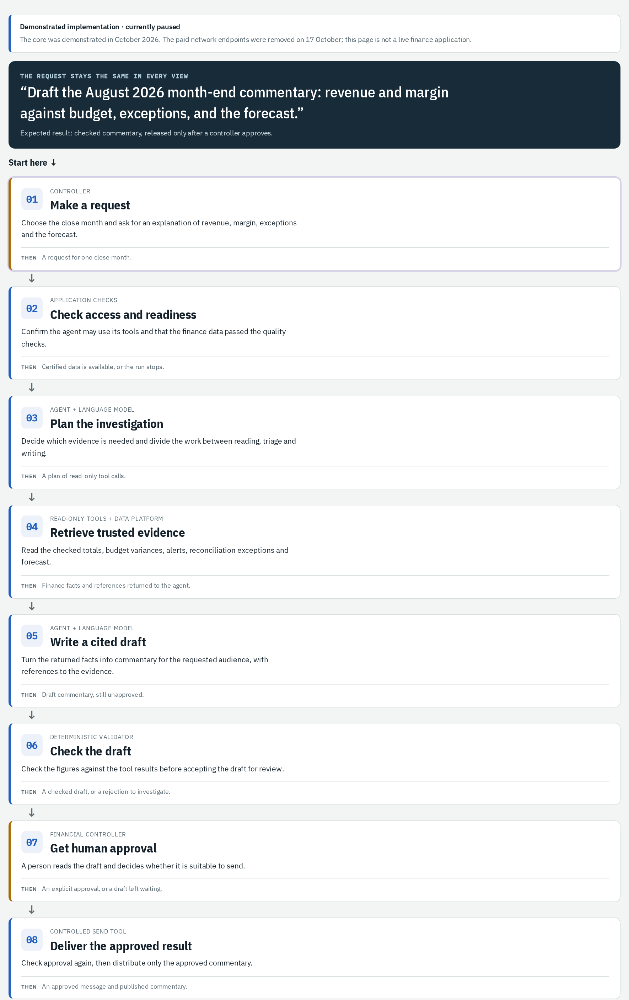

# High-Level Design

**Contents:** [TL;DR](#tldr) · [Diagram](#diagram) · [Before the request](#before-the-request) · [One run, step by step](#one-run-step-by-step) · [The parts, by where they run](#the-parts-by-where-they-run) · [Key flows](#key-flows) · [Design choices](#design-choices) · [Zoom in (LLDs)](#zoom-in-llds) · [Change the diagram](#change-the-diagram)

Explanation redesigned 2026-11-13; the demonstrated runtime is unchanged. Why: [business case](../conception/business-case.md).
Detail: `cmdb.yml` → `architecture.request_journey`, `decisions`; redesign: [X.3](../stories/X.3-request-journey.md).

## TL;DR

| Question | Answer |
|---|---|
| What does a person ask? | “Draft the August 2026 month-end commentary.” |
| How do I read the chart? | Start at 1 and follow the arrows down to 8; Expert opens the components inside those same stages |
| What is as built? | The implementation demonstrated in October; now paused after paid network endpoints were removed |
| What is the target? | The same month-end journey with proposed production additions, [not deployed](../target/reference-architecture.md) |
| What changed in this redesign? | Website and documentation only; no agent, pipeline, Terraform or cloud changes |
| What stays human? | Approval before distribution; financial postings, payments and money movement |

## Diagram

> **TL;DR:** one request proceeds down the page; cloud boundaries are supporting detail.

[Interactive request journey](https://kheuchi.github.io/retail-finance-platform-control-plane/architecture/architecture.html#built-hld).
The screenshot is a reading map, not a deployment topology. Simple and Expert use the same stages in the same positions.
The agent may repeat evidence reads while drafting; the numbered stages describe the overall lifecycle, not a fixed LLM trajectory.

## Before the request

> **TL;DR:** data preparation is scheduled work; asking a question does not rebuild the platform.

Synthetic source files → Bronze (as delivered) → Silver (typed, checked, quarantine) → reconciliation and certified Gold → ML results.
The agent reads the prepared totals, anomalies and forecast. Details: [data platform](lld-data-platform.md), [ML](lld-ml.md).

## One run, step by step

> **TL;DR:** request → check → plan → evidence → draft → validate → approve → deliver.

| # | Stage | Component hand-off | Result or gate |
|---|---|---|---|
| 1 | Make a request | Controller → agent run | One close month; no production chat portal |
| 2 | Check access and readiness | Agent identity → managed MCP → `gold_certification_status` | Stop if Gold is not certified; tool permissions constrain access |
| 3 | Plan the investigation | Deep Agents supervisor → Gemini EU → sub-agents | Read-only investigation plan |
| 4 | Retrieve trusted evidence | Managed MCP → Unity Catalog functions → SQL warehouse → Gold and ML results | Aggregates and references returned to the agent; no employee-level scores |
| 5 | Write a cited draft | Writer + model → draft per audience | Unapproved commentary |
| 6 | Check the draft | `submit_draft` → AgentCore Gateway → Lambda figure check → storage | Unsupported figures rejected; semantic correctness still needs review |
| 7 | Get human approval | Controller → approval row in `finance.agent.approvals` | The agent and notifier cannot approve |
| 8 | Deliver the approved result | Next run: `send_approved` → gateway + Lambda → SES and `gold.close_commentary` | Unapproved drafts refused |

The August demonstration produced three checked drafts; one was approved and emailed.
Power BI, Teams, ServiceNow and the CFO pack remain intended consumers or simulated edges, not connected production integrations.
Seven functions means six finance functions plus the certification function. Proof: [story 7.1](../stories/7.1-month-end-agent.md).

## The parts, by where they run

> **TL;DR:** hosting explains operations, not the order in which a reader follows the request.

| Location | Role | Detail |
|---|---|---|
| Google europe-west1 | Agent Engine, Gemini EU endpoint, agent credential store and logs | [Agent LLD](lld-agent.md) |
| AWS eu-central-1 | AgentCore send gateway, channel Lambda, SES, S3 and classic Databricks compute | [Network LLD](lld-network.md) |
| Databricks | Managed MCP, seven functions, SQL warehouse, governed tables, scheduled jobs and MLflow | [Data LLD](lld-data-platform.md) |
| GitHub | Three repos, checks and gated deployment workflows | [Identity LLD](lld-identity-cicd.md) |

Classic compute uses our private VPC; the agent SQL warehouse is serverless. Cross-cloud agent hops use HTTPS.
Secret Manager supports authentication and is deliberately outside the main request chart.

## Key flows

> **TL;DR:** separate request traffic from preparation and delivery of code.

| Path | Protection | Where in the journey |
|---|---|---|
| Agent → Databricks managed MCP | OAuth M2M, EXECUTE on seven functions; no direct table grants | 2 and 4 |
| Agent → Vertex EU model | Runtime service account | 3 and 5 |
| Google identity → AWS STS → AgentCore Gateway → Lambda | Federated identity, gateway-only role; validator and approval check outside model | 6 and 8 |
| Classic cluster → Databricks / S3 | PrivateLink / S3 gateway endpoint, Unity Catalog grants | Before the request |
| GitHub Actions → cloud deployment | Short-lived cloud federation, required checks and gated workflows | Outside request execution |

## Design choices

> **TL;DR:** preserve security controls while reducing visual clutter.

| Choice | Consequence |
|---|---|
| Synthetic data with planted anomalies | Known answer key, no real customer or employee data |
| Gold certification before analysis | The model cannot choose to bypass the readiness gate |
| Separate agent and notifier permissions | Read, store, approve and send remain distinct responsibilities |
| Budget alerts and auto-stop | Limit waste; USD 50 is an alerting budget, not a hard cloud spending cap |
| Eight stages across all site modes | Production additions can be compared without changing the use case |

## Zoom in (LLDs)

> **TL;DR:** use the detailed docs after following the request once.

| Detail | Relationship to the request |
|---|---|
| [1 · Network](lld-network.md) | Supporting connectivity and classic compute topology |
| [2 · Identity & CI/CD](lld-identity-cicd.md) | Request access and the separate change/deploy path |
| [3 · Data platform](lld-data-platform.md) | Preparation before the request; evidence reads at stage 4 |
| [4 · Observability & cost](lld-observability-cost.md) | Signals and budgets across every stage |
| [5 · ML](lld-ml.md) | Scores and forecast prepared before the request |
| [6 · Agent](lld-agent.md) | Components inside stages 1–8 |

The [enterprise target](../target/reference-architecture.md) extends this month-end journey.
[Margin recovery](../target/margin-recovery.md) remains a separate possible use case.

## Change the diagram

> **TL;DR:** edit the request model, then regenerate site screenshots.

The active site uses `site/src/data/journey.ts`, `site/src/components/Journey.svelte` and `site/src/styles/journey.css`.
Architecture, landscape and search share the request model. Existing `#built-hld`, `#target-hld` and LLD links resolve to the redesigned explanation.
Run the site build, then `site/scripts/diagram-shots.py` against the local preview to refresh `docs/architecture/img/`.
The detailed LLD tables remain the technical reference; screenshots now explain stage context rather than reproduce every deployment box.
