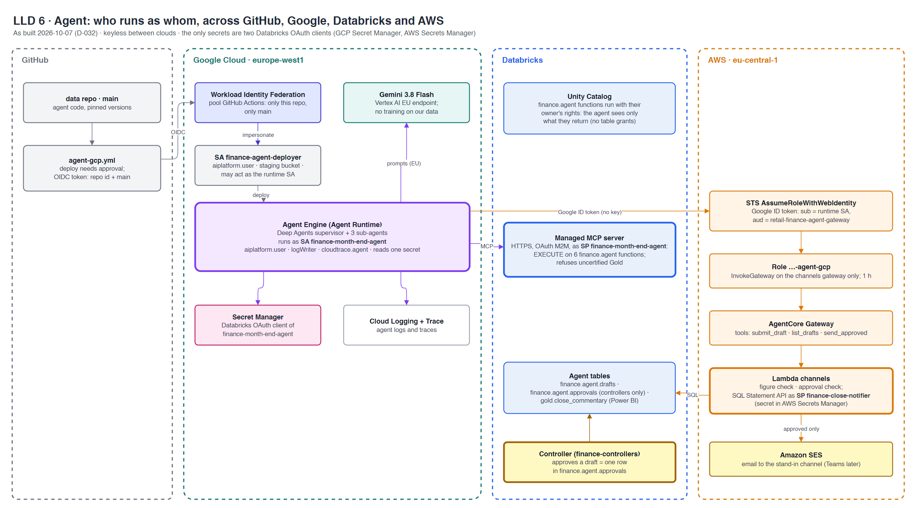

# LLD 6 · Agent

**Contents:** [TL;DR](#tldr) · [Diagram](#diagram) · [Identities](#identities) · [One run](#one-run) · [Why it is safe](#why-it-is-safe) · [Limits](#limits)

Updated 2026-10-29. As built 2026-10-07 (D-032). Back to [HLD](hld.md). Story: [7.1](../stories/7.1-month-end-agent.md).
Detail: [`cmdb.yml`](../../cmdb.yml) → `decisions` (D-029, D-032) · [ADR-006](../conception/adr/ADR-006-agent-platform.md).
Code: infra `gcp/` (Google side), infra `agent/` (gateway, federation, Lambda); data `agents/month_end_close/`, `.github/workflows/agent-gcp.yml`.

## TL;DR

| Question | Answer |
|---|---|
| Where does the agent run? | Google Agent Runtime (Vertex AI Agent Engine), europe-west1, with Gemini 3.8 Flash on the EU endpoint |
| What may it read? | Only what six Unity Catalog functions return, over Databricks managed MCP |
| What may it send? | Nothing directly: three gateway tools in AWS, and the Lambda behind them sends only approved drafts |
| How does it prove who it is? | GitHub → Google by OIDC; Google → AWS by an ID token; no cloud keys anywhere |
| Secrets? | Two Databricks OAuth clients: one in GCP Secret Manager (agent), one in AWS Secrets Manager (notifier) |

## Diagram

Source: [lld-agent.drawio](lld-agent.drawio).

## Identities

> **TL;DR:** five identities, each with one job and the smallest right that does it.

| Identity | Where | May | May not |
|---|---|---|---|
| `finance-agent-deployer` (service account) | Google | Deploy to Agent Runtime, write the staging bucket, act as the runtime SA | Run the agent; read the secret. Reachable only from the data repo's `main` (Workload Identity Federation condition) |
| `finance-month-end-agent` (service account) | Google | Call Gemini, write logs and traces, read its one secret | Anything else in the project |
| `finance-month-end-agent` (service principal) | Databricks | EXECUTE on the six `finance.agent` functions | Read any table directly; write anything |
| `…-agent-gcp` (IAM role) | AWS | `InvokeGateway` on the channels gateway, 1 h sessions; trusted only for the runtime SA's ID token with audience `retail-finance-agent-gateway` | Any other AWS call |
| `finance-close-notifier` (service principal) | Databricks, used by the Lambda | Write drafts, read approvals, publish to `gold.close_commentary` | Approve: only `finance-controllers` write `finance.agent.approvals` |

## One run

> **TL;DR:** read through functions, draft, wait for a person, then send.

| # | Step | Identity used |
|---|---|---|
| 1 | The agent checks Gold is certified, then calls the functions | Databricks SP `finance-month-end-agent` (OAuth M2M) |
| 2 | Gemini plans, delegates to sub-agents, writes drafts | Google SA `finance-month-end-agent` |
| 3 | `submit_draft`: the Lambda checks every figure against the tool results and stores the draft | AWS role `…-agent-gcp` → Lambda as `finance-close-notifier` |
| 4 | A controller approves: one row in `finance.agent.approvals` | A person in `finance-controllers` |
| 5 | Next run, `send_approved`: the Lambda sends the email (SES) and publishes the commentary | `finance-close-notifier` |

## Why it is safe

> **TL;DR:** the guardrails sit outside the model; a confused or tricked model still can't act.

| Control | Enforced by |
|---|---|
| Reads only aggregates, no employee-level data | The function definitions (reviewed in `agent_tools.sql`) |
| No send without approval | The Lambda checks `finance.agent.approvals`; the agent has no other route |
| No invented figures | The Lambda's figure check rejects a draft whose numbers aren't in the tool results |
| No deploy from a branch or a fork | Workload Identity Federation condition: repository ID + `refs/heads/main`; a manual approval on the deploy |
| No standing cloud keys | OIDC and ID-token federation on both cross-cloud hops |

## Limits

> **TL;DR:** stated, not hidden.

| Limit | Why accepted |
|---|---|
| Agent → Databricks and Google → AWS cross the internet (TLS) | AWS held AgentCore Runtime and Bedrock at zero (D-032); the AgentCore design keeps it private |
| Two long-lived Databricks OAuth secrets | Databricks federation for these identities not set up; rotation is manual |
| No alerts on agent failures or cost | Tokens only in the run output (no table); see [story 6.4](../stories/6.4-monitoring.md) |
