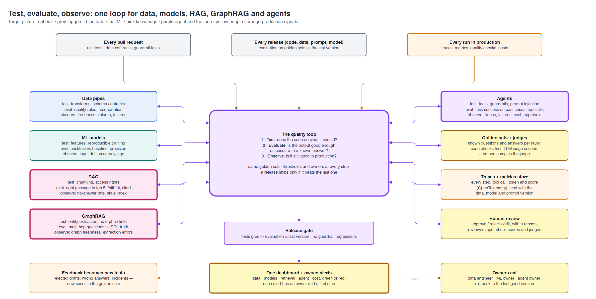

# Evaluation, testing and observability

**Contents:** [TL;DR](#tldr) · [Three words](#three-words) · [Per layer](#per-layer) · [The loop](#the-loop) · [Evaluating AI in practice](#evaluating-ai-in-practice) · [Here vs target](#here-vs-target)

Day 0 · Conception · 2026-10-29. Target picture only: nothing in this file is built.
Applies to this project and to the [reference architecture](reference-architecture.md). Built monitoring today: [story 6.4](../stories/6.4-monitoring.md).
Detail: [`cmdb.yml`](../../cmdb.yml) → `conception.evaluation_observability`.

## TL;DR

| Question | Answer |
|---|---|
| What is this? | How we would know that data pipes, ML models, RAG, GraphRAG and agents work, before release and in production |
| The one idea | One loop: **test** on every PR, **evaluate** on every release, **observe** every run; what goes wrong becomes a new test |
| The key asset | **Golden sets**: questions or cases with a known right answer, per layer, versioned like code |
| AI-specific | Outputs vary, so test the parts with code (tools, guardrails, citations) and score the rest on golden sets |
| Release rule | A new version (code, data, prompt or model) ships only if it is at least as good as the last one |

## Three words

> **TL;DR:** test the code, evaluate the output, observe production.

| Word | Question | When | Example |
|---|---|---|---|
| **Test** | Does the code do what it should? | Every pull request, in CI | "Silver drops a row with a negative quantity" |
| **Evaluate** | Is the output good enough on cases with a known answer? | Every release | "The forecast misses by less than the baseline on the last 3 months" |
| **Observe** | Is it still good in production? | Every run | "No new sales file since yesterday 07:00" |

## Per layer

> **TL;DR:** each layer gets its tests, its evaluation and its signals.

Source: [evaluation-observability.drawio](evaluation-observability.drawio).

| Layer | Test (CI) | Evaluate (release) | Observe (production) |
|---|---|---|---|
| **Data pipes** | Unit tests on transforms; schema contracts | Quality rules, reconciliation (GL = POS) | Freshness, row counts vs normal, rows set aside |
| **ML models** | Feature code; training gives the same result twice | Backtest vs a simple baseline; precision on labelled cases | Input drift (PSI), accuracy when actuals arrive, model age |
| **RAG** | Chunking keeps clause numbers; a user without rights gets nothing | The right passage is in the top 5; the answer is supported by its citation | "No answer" rate, index older than the source, user thumbs down |
| **GraphRAG** | Entity extraction on known contracts; no claim without a supplier | Multi-hop questions whose answer SQL can compute ("promotions of X with no claim") | Graph older than its sources, extraction errors |
| **Agents** | Each tool; guardrails (refuses an unapproved send, ignores instructions hidden in a document) | Task success on past cases with known outcomes; right tools called; every figure from a tool | Traces per step, failures, cost per run, approval rate, guardrail hits |

## The loop

> **TL;DR:** production teaches the tests.

1. **PR:** tests and guardrail tests must pass.
2. **Release:** run the golden sets; compare with the last version; block if worse.
3. **Production:** trace every run; dashboard and owned alerts.
4. **Feedback:** a rejected draft, a wrong answer or an incident becomes a new golden case, so the same mistake is caught next time.

## Evaluating AI in practice

> **TL;DR:** cheap code checks first, an LLM judge second, a person checks the judge.

| Practice | Example |
|---|---|
| Code checks first | Every number appears in a tool result; every claim has a citation; JSON matches its schema |
| LLM as judge, second | "Is this answer supported by the cited clause? yes / no, why" on a golden set |
| A person checks the judge | Sample 20 judged answers a month; if the judge disagrees with people, fix the judge |
| Version everything together | Each score is stored with the data, model, prompt and index version that produced it |
| Small golden sets, kept current | 50–200 cases per layer, grown from real failures, beat thousands of synthetic ones |
| Tools (examples) | Data: Databricks expectations, Lakehouse Monitoring, Great Expectations. ML: MLflow, Evidently. RAG and agents: MLflow evaluate and tracing, Ragas, Vertex AI evaluation, OpenTelemetry |

## Here vs target

> **TL;DR:** we test and record well; evaluation is partial; observation has no alerts.

| Layer | Here | Missing |
|---|---|---|
| Data pipes | ✅ Tests in CI, quality gates, certification, reconciliation | Freshness and volume alerts |
| ML models | ✅ Backtest vs baseline, PSI drift | Accuracy tracking when actuals arrive; alerts |
| RAG / GraphRAG | Not built | Everything above |
| Agent | 🟡 Tool and guardrail tests, figure check, traces and cost in `ops.agent_runs` | A golden set of past months; release gate on prompt or model changes; alerts |
