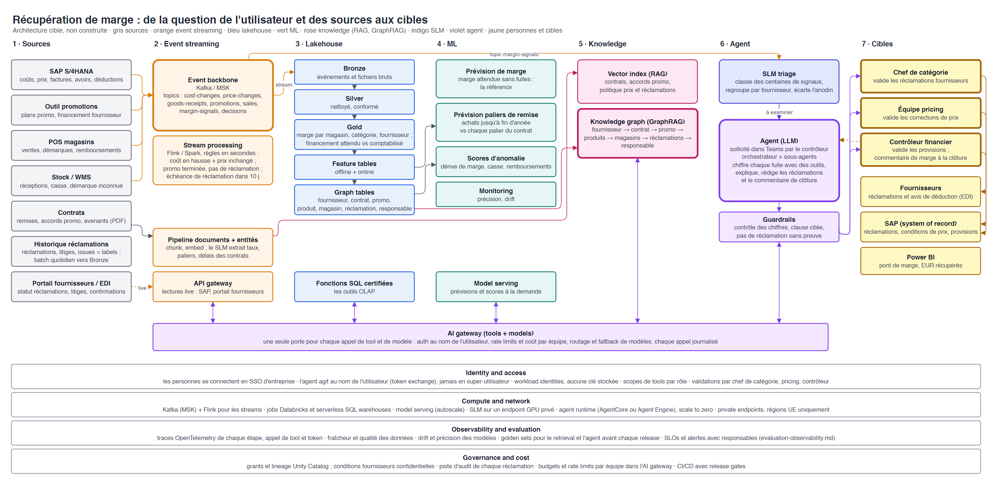
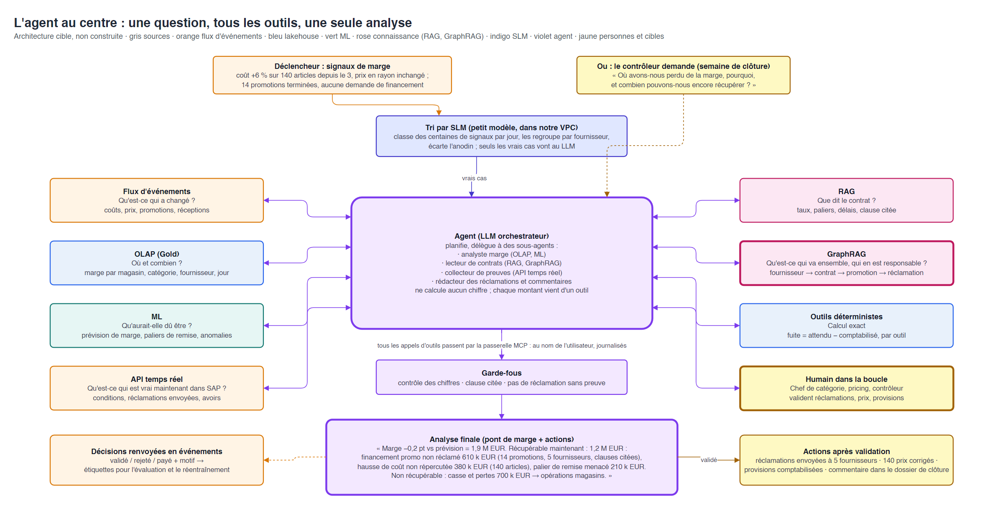

# Architecture de référence : un agent de récupération de marge

**Sommaire :** [TL;DR](#tldr) · [Quand un agent vaut le coup](#quand-un-agent-vaut-le-coup) · [La question](#la-question) · [Business case](#business-case) · [Build ou buy](#build-ou-buy) · [Sources et cibles](#sources-et-cibles) · [Flux des sources aux cibles](#flux-des-sources-aux-cibles) · [L'agent au centre](#lagent-au-centre) · [Couche par couche](#couche-par-couche) · [Un run de bout en bout](#un-run-de-bout-en-bout) · [Règles de conception](#règles-de-conception) · [Ce qui tourne mal en général](#ce-qui-tourne-mal-en-général) · [Équipes](#équipes) · [Comparaison avec ce projet](#comparaison-avec-ce-projet) · [Cas d'usage envisagés](#cas-dusage-envisagés)

Jour 0 · Conception · 2026-10-28. Image cible uniquement : rien dans ce fichier n'est construit.
Version française de [reference-architecture.md](reference-architecture.md) (l'anglais fait foi ; termes techniques laissés en anglais).
Détail : [`cmdb.yml`](../../cmdb.yml) → `conception.reference_architecture`.

## TL;DR

| Question | Réponse |
|---|---|
| C'est quoi ? | L'image entreprise complète d'un agent IA qui a besoin de **tous** les outils : event streaming, lakehouse + OLAP, live APIs, ML (prévisions + scores), RAG, GraphRAG, un SLM, des humains, et un LLM pour relier le tout |
| La question | **« Où avons-nous perdu de la marge ce mois-ci, pourquoi, et combien pouvons-nous encore récupérer avant de clôturer les comptes ? »** |
| Qui la pose | Le contrôleur financier et les chefs de catégorie de notre distributeur alimentaire fictif |
| Pourquoi un agent | La marge fuit par six systèmes et des centaines de contrats ; chaque fuite demande un chemin différent ; aucune règle fixe ni aucun produit unique ne les voit toutes |
| Pourquoi build | La marge est le cœur de l'économie d'un distributeur alimentaire ; les données et les contrats sont à nous ; la plateforme sert à chaque cas d'usage suivant. **Build la plateforme, buy les briques** |
| L'idée clé | Le LLM ne calcule **aucun** chiffre et n'envoie **rien** seul. Il trouve, chiffre (avec des tools), explique et rédige ; des personnes valident |
| Prolonge | Notre détecteur de marge magasin ([story 5.1](../stories/5.1-fraud-detection.md)) et l'agent de clôture mensuelle qui rédige le commentaire de marge ([story 7.1](../stories/7.1-month-end-agent.md)) |

## Quand un agent vaut le coup

> **TL;DR :** six tests ; si un seul échoue, une solution plus simple l'emporte.

| # | Test | S'il échoue, utiliser |
|---|---|---|
| 1 | Aucune règle fixe ne peut trancher ; il faut du jugement | Des règles dans l'ERP ou un moteur |
| 2 | Les preuves sont réparties sur plusieurs systèmes, texte compris | Une requête SQL ou un dashboard BI |
| 3 | Les étapes changent d'un cas à l'autre | Un workflow fixe avec une étape LLM |
| 4 | Volume modéré (des dizaines à des centaines de cas par jour), chacun valant de l'argent ou du temps | Un moteur pour le volume ; rien pour la faible valeur |
| 5 | Une personne peut vérifier le résultat, et les erreurs sont réversibles | Le laisser aux humains |
| 6 | Ça vaut la peine de construire : différenciant, nos données, plateforme réutilisable ; ou aucun produit ne fait tout | Buy |

La ligne de Gartner, telle que rapportée : l'automatisation pour les workflows routiniers, les assistants pour la
recherche d'information, **les agents quand il faut décider** ; Gartner prévoit aussi que plus de 40 % des projets
agentiques seront abandonnés d'ici 2027, surtout faute de valeur claire et à cause du coût.

| Test | Récupération de marge |
|---|---|
| 1 · Jugement | ✅ Cette fuite est-elle réelle, récupérable, vaut-elle une discussion avec le fournisseur ? |
| 2 · Plusieurs systèmes + texte | ✅ SAP, promotions, POS, stock, portail fournisseurs, contrats |
| 3 · Étapes variables | ✅ Une erreur de prix et une promo non réclamée suivent des chemins différents |
| 4 · Volume et valeur | ✅ Des dizaines de cas par jour, des milliers d'euros chacun |
| 5 · Vérifiable, réversible | ✅ Chaque réclamation, changement de prix et provision est validé d'abord |
| 6 · Vaut la peine de construire | ✅ Voir [build ou buy](#build-ou-buy) |

## La question

> **TL;DR :** une question pour le contrôleur, découpée en sous-questions ; chacune traitée par un outil différent.

> **« Où avons-nous perdu de la marge ce mois-ci, pourquoi, et combien pouvons-nous encore récupérer avant de clôturer les comptes ? »**

| Sous-question | Traitée par |
|---|---|
| Qu'est-ce qui a changé ? | **Event streaming** : changements de coût, de prix, promotions, réceptions |
| Quels signaux méritent un examen ? | **SLM** : classe et regroupe des centaines de signaux par jour |
| Où, et combien ? | **OLAP** sur Gold : marge par magasin, catégorie, fournisseur, jour |
| Quelle aurait dû être la marge ? | **ML forecast** : marge attendue sans la fuite ; achats jusqu'à fin d'année vs paliers de remise |
| Qu'est-ce qui paraît anormal ? | **ML scores** : dérive de marge, casse, remboursements |
| Qu'est-ce qui est vrai maintenant ? | **Live APIs** : conditions de coût et de prix actuelles dans SAP, réclamations déjà envoyées, avoirs reçus, litiges ouverts |
| Que dit le contrat ? | **RAG** : la clause, citée (« le fournisseur finance 30 % de la remise promo, réclamation sous 60 jours ») |
| Qu'est-ce qui va ensemble, et qui en est responsable ? | **GraphRAG** : fournisseur → contrat → promo → produits → magasins → réclamations → acheteur |
| Quelle est la taille exacte de chaque fuite ? | **Deterministic tools** : fuite = attendu − comptabilisé |
| Alors, que fait-on ? | **LLM** : pont de marge, projets de réclamation, liste de prix à corriger, commentaire de clôture |
| Qui décide ? | **Humains** : chef de catégorie (réclamations), équipe pricing (prix), contrôleur (provisions) |

## Business case

> **TL;DR :** en distribution alimentaire, quelques dixièmes de point de marge font tout le bénéfice ; ils fuient par des trous qu'aucun système ni aucune équipe ne voit seul.

| Question | Réponse |
|---|---|
| Problème | La marge nette en distribution alimentaire est d'environ 1 à 3 % des ventes. Elle fuit par de nombreux petits trous, chacun porté par un système et une équipe différents |
| Comment c'est traité aujourd'hui | Déjà largement automatisé : SAP règle remises et financements promo à partir des conditions saisies, les outils de pricing signalent les coûts non répercutés, la BI montre le pont de marge, le ML score les anomalies. Ce qui passe entre les mailles (conditions seulement en PDF, systèmes qui divergent) est trouvé par des analystes, ou par des cabinets de recovery audit **des mois plus tard** contre une part. Voir [avant l'IA](#avant-lia) |
| Ce que fait l'agent | Surveille les événements, trouve et chiffre chaque fuite, la relie au contrat et au responsable, rédige la réclamation ou la correction, et écrit le commentaire de marge pour la clôture |
| Qui décide | Chef de catégorie, équipe pricing, contrôleur financier. Rien ne part vers un fournisseur ni dans le grand livre automatiquement |
| Mesuré par | EUR récupérés dans le mois, réclamations envoyées avant leur échéance, marge expliquée à la clôture (part de l'écart avec une cause nommée), heures d'analyste économisées |
| Hors objectif | Négocier avec les fournisseurs ou changer des prix sans une personne |

### Les fuites

| Fuite | Exemple | Récupérable ? | Responsable |
|---|---|---|---|
| Financement promo non réclamé | La promo a eu lieu ; la contribution convenue du fournisseur n'a jamais été facturée | Oui, avant l'échéance de réclamation | Chef de catégorie |
| Coût en hausse, prix inchangé | Le fournisseur a augmenté son coût le 3 ; le prix en rayon n'a jamais été mis à jour | En partie, à partir d'aujourd'hui | Pricing |
| Palier de remise menacé | 80 k EUR sous le palier suivant à deux mois de la fin | Oui, en déplaçant des achats | Chef de catégorie |
| Déductions fournisseurs non prises ou non défendues | Une livraison en retard ou incomplète qu'on avait le droit de facturer ; un fournisseur conteste notre déduction et on ne retrouve pas la preuve | Oui, avec preuves | Comptabilité fournisseurs |
| Démarque et casse | La casse en frais a doublé dans 12 magasins | Non ; transmis aux opérations magasins | Opérations magasins |
| Fraude | Schéma de remboursements sur deux caisses | En partie ; transmis à la prévention des pertes | Prévention des pertes |
| Démarques excessives | Soldes de déstockage lancées trop tôt | Non ; leçon pour la prochaine fois | Pricing |

### Avant l'IA

> **TL;DR :** les moteurs font déjà les calculs ; l'IA couvre ce qu'ils n'ont jamais su faire : lire, relier, enquêter, rédiger.

Avant 2022, les grands distributeurs ne faisaient pas cela à la main :

| Exemple | Outil | Déjà automatisé | Encore laissé aux personnes |
|---|---|---|---|
| Une remise de 2 % au-delà de 1 M EUR d'achats | Contrats de conditions SAP, Vistex | Provision et règlement, une fois la condition saisie | Un avenant en PDF que personne n'a saisi |
| Le fournisseur finance 30 % d'une promo | Outil promotions + SAP | Réclamation générée à la fin de la promo | Promo modifiée tard, SAP et le plan divergent |
| Coût +6 %, prix en rayon inchangé | Outil de pricing, règle d'exception SAP | Une alerte | Pourquoi, qui est responsable, ce que permet le contrat |
| Marge 0,2 pt sous le plan | Pont de marge BI, prévision ML | Où se trouve l'écart | Pourquoi, et le commentaire de clôture |
| Ce qui est passé quand même | Cabinet de recovery audit | Trouvé un an plus tard | Payé en part de ce qui est récupéré |

**Ce qu'apporte l'IA :** elle lit contrats et e-mails, relie les faits entre systèmes, vérifie chaque alerte contre SAP
et le contrat, et rédige la réclamation et le commentaire. **Elle ne remplace pas** les moteurs, la BI ni les modèles
ML : elle les appelle comme tools. La valeur, c'est l'écart qu'ils laissent, trouvé dans le mois plutôt qu'un an après.

## Build ou buy

> **TL;DR :** build la plateforme et l'agent là où la question nous est propre ; buy les briques banalisées.

| Critère | Récupération de marge |
|---|---|
| Différenciant ? | Oui : la marge est l'économie du distributeur ; savoir tôt pourquoi elle a bougé est un avantage |
| Transverse aux silos ? | Six systèmes plus les contrats ; chaque éditeur couvre un silo (prix, remises, déductions, prévention des pertes) |
| Nos données ? | Contrats, promotions, coûts et prix sont confidentiels et propres à nous |
| Réutilisation de la plateforme ? | Même lakehouse, gateway, agent runtime et contrôles que l'agent de clôture ; le cas d'usage suivant coûte peu |
| Maîtrise ? | Résidence UE, piste d'audit, nos guardrails, pas de conditions fournisseurs dans le cloud d'un éditeur |
| Modèle de coût ? | Les cabinets de recovery audit prennent une part de ce qu'ils trouvent ; le prix IA par utilisateur grimpe avec le nombre d'utilisateurs |
| **Buy** | Les modèles (LLM, SLM), le service de streaming, les stores vectoriels et graphe, l'OCR, l'agent runtime |
| **Build** | Gold, graph tables, tools, la logique de l'agent, l'évaluation, les guardrails |

## Sources et cibles

> **TL;DR :** sept sources en entrée, six cibles en sortie ; les événements circulent dans les deux sens.

### Sources

| Source | Fournit | Comment ça arrive | Fraîcheur |
|---|---|---|---|
| SAP S/4HANA | Coûts, prix, commandes d'achat, factures, avoirs, déductions | Événements CDC ; lectures live via l'API gateway | Secondes |
| Outil promotions | Plans promo, dates, financement fournisseur convenu | Événements | Minutes |
| POS magasins | Ventes, démarques, remboursements | Événements | Secondes |
| Stock / WMS | Réceptions, casse, démarque inconnue | Événements | Minutes |
| Contrats | Accords de remise, accords promo, avenants (PDF) | Pipeline documents + entités | À chaque version signée |
| Historique réclamations | Réclamations passées, litiges et issues : les **labels** | Batch quotidien | Quotidienne |
| Portail fournisseurs / EDI | Statut des réclamations, litiges, confirmations | Live API ; messages EDI en événements | Minutes |

### Cibles

| Cible | Reçoit | Après |
|---|---|---|
| **Chef de catégorie** | Projets de réclamation avec clause et preuves ; paliers de remise menacés | L'agent |
| **Équipe pricing** | Liste de prix à corriger (coût en hausse, prix inchangé) | L'agent |
| **Contrôleur financier** | Propositions de provisions ; pont de marge et commentaire pour la clôture | L'agent |
| **Fournisseurs** | Réclamations et avis de déduction par EDI ou portail | Validation du chef de catégorie |
| **SAP** (system of record) | Documents de réclamation, conditions de prix, écritures de provision, via des workflows avec les contrôles propres à SAP | Validation |
| **Power BI** | Pont de marge, EUR récupérés, réclamations par statut | Lit Gold |
| **Event backbone** (retour) | Validé, rejeté, payé, avec le motif | Chaque décision ; devient le label suivant |

## Flux des sources aux cibles

> **TL;DR :** les données vont de gauche à droite à travers streaming, lakehouse, ML et knowledge ; chaque appel d'outil passe par une seule gateway.

| Colonne | Contient |
|---|---|
| 1 · Sources | Les sept systèmes ci-dessus |
| 2 · Event streaming | Event backbone, stream processing (les règles de signaux de marge), pipeline documents + entités, API gateway |
| 3 · Lakehouse | Bronze → Silver → Gold, feature tables, graph tables, fonctions SQL certifiées |
| 4 · ML | Prévision de marge, prévision des paliers de remise, scores d'anomalie, monitoring, serving |
| 5 · Knowledge | Vector index (RAG), knowledge graph (GraphRAG) |
| 6 · Agent | SLM triage, agent LLM, guardrails |
| 7 · Cibles | Trois valideurs d'abord, puis les systèmes qui agissent ; le contrôleur sollicite aussi l'agent (Teams) |
| AI gateway (en bas) | Une seule porte pour chaque appel de tool et de modèle : auth au nom de l'utilisateur, rate limits et coût par équipe, routage et fallback de modèles, journalisation (AgentCore Gateway le permet depuis ses mises à jour d'août–octobre 2026 ; alternatives : Apigee, Databricks AI Gateway, LiteLLM) |
| Bandeaux | Identity and access · compute and network · observability and evaluation ([evaluation-observability.md](evaluation-observability.md)) · governance and cost |

Source : [reference-architecture-flow.fr.drawio](reference-architecture-flow.fr.drawio).

## L'agent au centre

> **TL;DR :** un déclencheur, neuf types de preuves, un pont de marge, trois décisions humaines.

L'agent planifie, puis délègue à des sous-agents : un **analyste marge** (OLAP, ML), un **lecteur de contrats** (RAG,
GraphRAG), un **collecteur de preuves** (live APIs) et un **rédacteur des réclamations et commentaires**. Source :
[reference-architecture-agent.fr.drawio](reference-architecture-agent.fr.drawio).

**Quand il tourne :** sur les événements de signal de marge qui passent le triage SLM ; chaque jour de la semaine de
clôture ; ou quand le contrôleur pose la question. Jamais une fois par vente ou par changement de prix : les règles de
stream et le SLM filtrent d'abord.

## Couche par couche

> **TL;DR :** chaque couche a un rôle, un responsable et une interface que l'agent peut utiliser.

### Event streaming

> **TL;DR :** la marge bouge quand un coût, un prix ou une promo change ; le stream le voit le jour même, pas en fin de mois.

| Composant | Pratique |
|---|---|
| Event backbone | Kafka (Amazon MSK, Confluent) ou SAP Event Mesh ; topics `cost-changes`, `price-changes`, `goods-receipts`, `promotions`, `sales`, `margin-signals`, `decisions` |
| CDC depuis SAP | SAP SLT, réplication Datasphere ou Debezium ; les changements de conditions et de factures deviennent des événements |
| Schema registry | Schéma versionné par topic ; changements cassants rejetés (le data contract du stream) |
| Stream processing | Flink ou Spark Structured Streaming. Règles : coût en hausse et prix inchangé après 2 jours ; promo terminée et pas de réclamation après 7 jours ; échéance de réclamation dans 10 jours ; publication sur `margin-signals` |
| Vers le lakehouse | Ingestion streaming dans Bronze ; streaming tables là où la fraîcheur compte |
| En sortie | Décisions sur `decisions` : audit, évaluation, labels |

### Lakehouse et OLAP

> **TL;DR :** l'historique de marge fiable et les liens dont le graphe a besoin.

| Composant | Pratique |
|---|---|
| Bronze → Silver → Gold | Quality gates ; marge par magasin, catégorie, fournisseur, jour ; financement **attendu** (d'après les accords) vs **comptabilisé** (d'après SAP) |
| Graph tables | Nœuds : fournisseur, contrat, clause, promo, produit, magasin, réclamation, acheteur. Arêtes : finance, couvre, vendu à, réclamé par, appartient à |
| Fonctions SQL certifiées | Les tools OLAP que l'agent peut appeler |
| Gouvernance | Grants et lineage Unity Catalog ; conditions fournisseurs lisibles seulement par les rôles finance et achats |

### ML : prévisions et scores

> **TL;DR :** la prévision dit ce qu'aurait dû être la marge ; les scores disent où elle paraît fausse.

| Modèle | Pratique |
|---|---|
| Prévision de marge | Marge attendue par catégorie et magasin (mix, promos, saisonnalité) ; l'écart au réel est ce que l'agent explique ; doit battre une baseline naïve |
| Prévision des paliers de remise | Achats jusqu'à fin d'année par fournisseur vs chaque palier du contrat, avec un intervalle |
| Scores d'anomalie | Dérive de marge, casse, remboursements par magasin (notre détecteur de la story 5.1, étendu) |
| Labels | Réclamations passées et issues (payée, rejetée, pourquoi) depuis l'historique et le topic `decisions` |
| Monitoring | Précision des prévisions, précision des scores, drift |

### Live APIs

> **TL;DR :** avant que quoi que ce soit parte vers un fournisseur, vérifier SAP et le portail à l'instant.

| Tool | Renvoie |
|---|---|
| `get_conditions(supplier, sku)` | Coût et prix actuels dans SAP, date de validité |
| `get_claims(supplier, period)` | Réclamations déjà envoyées, leur statut |
| `get_credit_notes(supplier, period)` | Argent déjà reçu |
| `get_disputes(supplier)` | Litiges ouverts sur le portail fournisseurs |

Le tout derrière une API gateway avec quotas et cache ; chaque réponse porte un `as_of`.

### SLM

> **TL;DR :** un small language model fait le travail de volume, à bas coût et dans notre réseau.

| Usage | Pourquoi un SLM |
|---|---|
| Classer et regrouper des centaines de signaux de marge par jour | Un appel LLM par signal coûte trop cher |
| Extraire taux, paliers, exclusions et échéances de milliers de contrats | Tâche étroite, fine-tunée une fois, relue par une personne |
| Garder les conditions fournisseurs dans le VPC pour ces étapes | Les données confidentielles restent chez nous |
| Exemples | Llama 3.2 3B, Phi, Gemma, Mistral Small ; sur notre propre GPU ou un endpoint privé |

### RAG

> **TL;DR :** la clause exacte, citée, lisible seulement par ceux qui y ont droit.

| Composant | Pratique |
|---|---|
| Contenu | Accords de remise et de promo, avenants, politique de prix, politique de réclamation |
| Index | Databricks Vector Search, Bedrock Knowledge Bases ou Azure AI Search ; chunks avec fournisseur, version, validité |
| Droits | Les droits d'accès de la source appliqués au moment de la requête |
| Réponses | Document, section et version cités ; « aucune clause trouvée » veut dire aucune réclamation |

### GraphRAG

> **TL;DR :** le RAG trouve la clause ; le GraphRAG trouve ce qui va ensemble et qui en est responsable.

| Composant | Pratique |
|---|---|
| Ce que c'est | Une recherche sur un knowledge graph : entités, leurs liens, et des résumés écrits par LLM pour chaque groupe, au lieu de seulement des chunks de texte |
| Graphe | Graph tables (liens structurés) plus les entités que le SLM extrait des contrats |
| Store | Neo4j, Amazon Neptune, ou graph tables dans le lakehouse |
| Requêtes | « Quelles promos terminées de ce fournisseur n'ont pas de réclamation, sous quel accord, avec quel responsable ? » ; « Quels autres fournisseurs ont le même schéma non réclamé ? » |
| Pourquoi pas du RAG simple | Le RAG simple renvoie du texte similaire ; il ne sait pas suivre promo → accord → clause → produits → réclamations |

### Agent LLM

> **TL;DR :** planifie, appelle des tools, relie les preuves, rédige ; ne calcule jamais, n'envoie jamais.

| Composant | Pratique |
|---|---|
| Déclencheurs | Événements de signal de marge après triage SLM ; run quotidien en semaine de clôture ; la question du contrôleur |
| Orchestrateur | Planifie et délègue aux sous-agents (analyste marge, lecteur de contrats, collecteur de preuves, rédacteur) |
| Tools | Via **MCP** (Model Context Protocol) derrière une seule gateway : auth au nom de l'utilisateur, policy par tool, chaque appel journalisé |
| Guardrails | Figure check (chaque chiffre vient d'un tool), une clause citée pour chaque réclamation, pas de réclamation sans preuve, filtre de prompt injection sur les documents |
| Runtime | AgentCore, Vertex AI Agent Engine ou Azure AI Foundry, dans l'UE |

### Humains

> **TL;DR :** trois responsables, trois types de décision.

| Action | Qui décide |
|---|---|
| Envoyer une réclamation à un fournisseur | Chef de catégorie |
| Changer un prix | Équipe pricing |
| Passer une provision ; publier le commentaire de marge | Contrôleur financier |
| Plus tard, peut-être automatique | Réclamations sous un petit seuil avec clause citée et un taux d'acceptation passé élevé, après des mois de preuves (niveau d'autonomie 4) |

### Transverse

> **TL;DR :** identité, confidentialité, observability, évaluation, coût.

| Sujet | Pratique |
|---|---|
| Confidentialité | Conditions fournisseurs réservées à la finance et aux achats ; résidence UE |
| Identité | Workload identities, aucune clé stockée ; les tools s'exécutent au nom de l'utilisateur |
| Observability | Traces de chaque étape (prompt, appels de tools, tokens) ; lag du stream ; drift des modèles |
| Évaluation | Mois passés avec réclamations et issues connues ; à chaque changement de prompt, de modèle ou de tool |
| Coût | SLM pour le volume, LLM pour les vrais cas ; budgets de tokens |
| Audit | Chaque réclamation traçable jusqu'aux événements, tables, clause et valideur |

## Un run de bout en bout

> **TL;DR :** semaine de clôture, jour 2 : le contrôleur pose la question ; 20 minutes plus tard, un pont de marge avec 1,2 M EUR récupérables.

Ventes mensuelles 950 M EUR ; marge 0,2 point sous la prévision.

| # | Qui | Fait | Obtient |
|---|---|---|---|
| 1 | Contrôleur | Pose la question dans Teams | Un cas |
| 2 | SLM | Récupère les 312 signaux de marge du mois, les regroupe par fournisseur | 23 vrais cas |
| 3 | OLAP | `margin_by_category_supplier(month)` | Écart concentré sur crèmerie, boissons, frais |
| 4 | ML forecast | `expected_margin(month)` | Écart de **1,9 M EUR** vs prévision (calculé par un tool) |
| 5 | GraphRAG | `unclaimed_promotions(month)` | 14 promos terminées, 5 fournisseurs, aucune réclamation ; responsables nommés |
| 6 | RAG | `contract_clause(supplier, promotion)` | Taux de financement et échéances de réclamation, cités |
| 7 | Live APIs | `get_claims`, `get_credit_notes`, `get_conditions` | Aucune réclamation envoyée ; 140 articles avec coût +6 % depuis le 3 et prix en rayon inchangé |
| 8 | ML + tools | Prévision des paliers de remise ; `leak_size` pour chaque cas | Financement promo 610 k EUR, coût non répercuté 380 k EUR, palier de remise menacé 210 k EUR ; casse 700 k EUR non récupérable |
| 9 | LLM | Pont de marge, 5 projets de réclamation, liste de prix à corriger, commentaire ; les guardrails vérifient chaque chiffre et chaque clause | Analyse finale |
| 10 | Humains | Les chefs de catégorie valident 5 réclamations ; le pricing corrige 140 prix ; le contrôleur passe les provisions | Réclamations envoyées, prix corrigés, commentaire dans le dossier de clôture ; événements `decisions` publiés |

610 + 380 + 210 = 1,2 M EUR récupérables ; avec la casse, 1,9 M EUR expliqués. Sans l'agent, une partie des 610 k EUR
reviendrait l'an prochain via un recovery audit, moins ses honoraires, et certaines réclamations dépasseraient leur
échéance.

## Règles de conception

> **TL;DR :** dix règles qui séparent une démo d'un agent en production.

1. **Les chiffres viennent des tools**, jamais du modèle ; un figure check l'impose.
2. **Pas de clause, pas de réclamation :** chaque réclamation cite sa clause de contrat et ses preuves.
3. **Chaque fait vient de son propriétaire :** l'historique de Gold, le présent de SAP, les conditions du contrat, les liens du graphe, « l'attendu » de la prévision.
4. **Montrer fraîcheur et sources :** chaque chiffre porte son `as_of` et son origine.
5. **SLM pour le volume, LLM pour le jugement.**
6. **Règles strictes dans le code, explications dans le RAG :** échéances et taux vivent dans des tables une fois extraits ; le PDF est la preuve.
7. **Read-only par défaut ;** chaque écriture passe par la gateway, un workflow et une personne.
8. **Event-driven :** les signaux lancent le travail ; rien n'interroge SAP en boucle.
9. **Évaluer avant de livrer** sur des mois passés aux issues connues.
10. **Tout tracer,** pour qu'un auditeur ou un litige fournisseur puisse rejouer pourquoi une réclamation a été envoyée.

## Ce qui tourne mal en général

> **TL;DR :** la plupart des échecs viennent des données et des processus, pas du modèle.

| Échec | Cause | Prévention |
|---|---|---|
| Mauvaise réclamation envoyée | Clause mal lue ou ancienne version du contrat | Clause citée avec sa version ; le chef de catégorie valide |
| Mauvais montant | Le modèle a fait le calcul | Deterministic tool, figure check |
| Réclamation envoyée deux fois | SAP pas vérifié à l'instant | Vérification par live API avant chaque projet |
| Avalanche de signaux | Une hausse générale des prix déclenche des milliers de signaux | Règles de stream groupées par fournisseur ; triage SLM |
| Fuite des conditions contractuelles | L'index ignore les droits | Filtres d'accès à la requête ; résidence UE |
| Relation fournisseur abîmée | Trop de petites réclamations | Seuils par fournisseur, fixés par les chefs de catégorie |
| Les labels ne s'améliorent jamais | Issues non capturées | Topic `decisions` ; payé / rejeté enregistré |

## Équipes

> **TL;DR :** le même modèle à deux équipes que dans ce projet, plus les responsables métier.

| Équipe | Porte |
|---|---|
| Équipe produit data & IA finance | Gold, graph tables, prévisions, tools, agent, évaluation |
| Équipe plateforme data & IA | Lakehouse, event backbone, serving, stores vectoriels et graphe, hébergement SLM, agent runtime, gateway |
| Équipe intégration | CDC SAP, outil promotions, portail fournisseurs et EDI |
| Achats (chefs de catégorie) | Réclamations, relations fournisseurs, seuils |
| Pricing | Corrections de prix |
| Finance (contrôleur, comptabilité fournisseurs) | Provisions, commentaire, déductions |

## Comparaison avec ce projet

> **TL;DR :** on a construit le lakehouse, un détecteur de marge, une prévision et un agent gouverné qui rédige le commentaire de marge ; pas le streaming, les live APIs, le RAG, le GraphRAG ni le SLM.

| Couche | Ici | Statut |
|---|---|---|
| Lakehouse + OLAP | Bronze/Silver/Gold, quality gates, certification ; l'agent lit des fonctions SQL certifiées dont `store_margin_alerts` | ✅ Construit |
| ML : scores | Détecteurs Isolation Forest : dérive de marge magasin et remboursements caissiers, mensuels | 🟡 Construit, en batch |
| ML : prévision | Prévision de chiffre d'affaires qui doit battre une baseline | 🟡 Construit, CA et non marge |
| Event streaming | Fichiers quotidiens avec Auto Loader | ❌ Non construit |
| Live APIs | Aucune ; la gateway porte des actions (brouillons, e-mails validés) | ❌ Non construit |
| RAG / GraphRAG | Aucun ; pas de contrats dans les données | ❌ Non construit |
| SLM | Aucun ; un seul LLM (Gemini) fait tout | ❌ Non construit |
| Agent LLM | Superviseur + 3 sous-agents, figure check, commentaire de marge à la clôture | ✅ Construit |
| Humains | Le contrôleur valide chaque brouillon | ✅ Construit |

Détail de ce qui est construit : [story 5.1](../stories/5.1-fraud-detection.md), [story 7.1](../stories/7.1-month-end-agent.md),
[ADR-006](adr/ADR-006-agent-platform.md).

## Cas d'usage envisagés

> **TL;DR :** trois candidats écartés, chacun pour une raison claire.

| Candidat | Pourquoi écarté |
|---|---|
| Réapprovisionnement magasin (« transférer ou commander ? ») | Un moteur de réappro (SAP F&R, RELEX) passe déjà les commandes sans LLM ; un agent ne traiterait que les exceptions |
| Réseaux de fraude au remboursement | Utilise tous les outils, mais des produits spécialisés (p. ex. Appriss Retail) relient déjà les cas avec graphes et LLM ; un argument build plus faible |
| Litiges de déductions fournisseurs (vendor chargebacks) | Un vrai problème, mais pour les **fournisseurs** qui contestent les déductions des distributeurs. Pour un distributeur c'est une fuite parmi d'autres (déductions non prises ou non défendues), désormais intégrée à ce cas d'usage |
