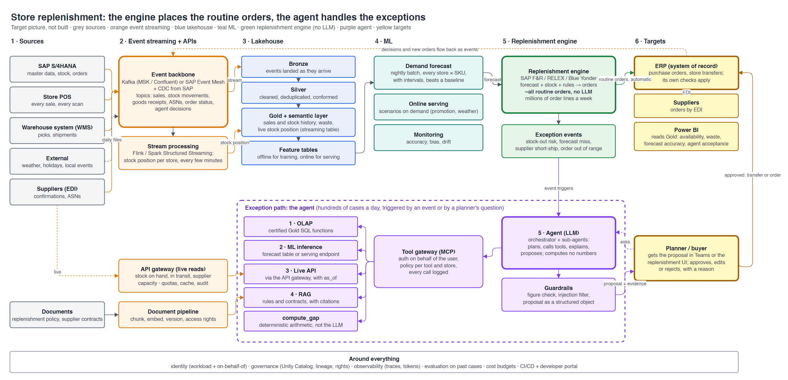

# Reference architecture: a decision agent on a lakehouse

**Contents:** [TL;DR](#tldr) · [Business case](#business-case) · [Sources and targets](#sources-and-targets) · [The pattern](#the-pattern) · [Big picture](#big-picture) · [Layer by layer](#layer-by-layer) · [One run, end to end](#one-run-end-to-end) · [Design rules](#design-rules) · [Autonomy levels](#autonomy-levels) · [What usually goes wrong](#what-usually-goes-wrong) · [Teams and cost](#teams-and-cost) · [How this project compares](#how-this-project-compares)

Day 0 · Conception · 2026-10-28. Target picture only: nothing in this file is built.
Previous: [benchmark](benchmark.md). Detail: [`cmdb.yml`](../../cmdb.yml) → `conception.reference_architecture`.

## TL;DR

| Question | Answer |
|---|---|
| What is this? | The full enterprise picture of an agent that combines **OLAP + ML + live APIs + RAG + LLM** |
| Which use case? | **Store replenishment exceptions** for the same fictional retailer: keeping shelves stocked without over-ordering fresh goods. Not this project's use case (ours is the month-end close) |
| The one idea | The LLM computes **no** numbers. It decides which system to ask, combines the answers, explains them and proposes an action |
| The big real-life caveat | A **replenishment engine** (SAP F&R, RELEX, Blue Yonder) already places the routine orders without any LLM. The agent handles the **exceptions** the engine cannot settle, and explains them |
| Why event streaming? | Stock changes every minute. Sales, deliveries and supplier messages travel as events: they feed the lakehouse, keep a live stock position and **trigger** the agent |
| Built here? | Lakehouse, batch ML and the LLM with human approval: yes. Streaming, live APIs, RAG, on-demand inference: no ([comparison](#how-this-project-compares)) |

## Business case

> **TL;DR:** empty shelves lose sales, full back rooms waste fresh food; the engine handles volume, the agent handles judgement.

| Question | Answer |
|---|---|
| Problem | Out-of-stocks cost a grocer a few percent of sales; over-ordering fresh goods becomes waste. A retailer with 1,000 stores and 30,000 SKUs places millions of order lines a week |
| What already exists | A replenishment engine: forecast + stock + rules → automatic orders. It handles more than 95% of lines well |
| What goes wrong today | Exceptions: a supplier ships short, a heatwave, a promotion that sells faster than forecast, a delivery stuck in a warehouse. Planners find them late, in reports, and spend hours gathering stock figures, forecasts and contract terms by hand |
| What the agent does | Picks up each exception as an event, gathers the evidence from the five systems, proposes a store-to-store transfer, an extra order or "wait", with the reasons and the sources |
| Who decides | The planner or buyer approves, edits or rejects. The ERP executes, with its own checks |
| Measured by | Fewer out-of-stocks on exception items, less fresh waste, planner hours saved per exception, share of proposals accepted unchanged |
| Not the goal | Replacing the engine or the planners; letting an LLM place orders on its own |

Terms: **SKU** (stock keeping unit) = one product in one pack size; **planner** = the person who manages stock for a region
or category; **buyer** = the person who manages a supplier.

## Sources and targets

> **TL;DR:** six sources in, three kinds of targets out; events flow both ways.

### Sources

| Source | Gives | How it arrives | Freshness |
|---|---|---|---|
| SAP S/4HANA | Master data (stores, SKUs, suppliers), stock, purchase orders, goods receipts | CDC (change data capture) into the event backbone; live reads through the API gateway | Seconds |
| Store POS (point of sale) | Every sale and return | Events from the stores | Seconds to minutes |
| Warehouse system (WMS) | Picks, shipments to stores, stock in the warehouse | Events; live reads | Minutes |
| Suppliers | Order confirmations, ASNs (advance shipping notices: "this is on the truck"), capacity | EDI (electronic data interchange) messages turned into events; supplier portal APIs | Minutes to hours |
| External data | Weather forecast, public holidays, local events | Daily files or APIs | Daily |
| Documents | Replenishment policy, supplier contracts (minimum order quantities, delivery days, penalties) | Document pipeline into a vector index | When a new version is signed |

### Targets

| Target | Receives | From |
|---|---|---|
| **ERP** (system of record) | Routine purchase orders and transfers (automatic); approved exception orders and transfers | The engine; the planner's approval |
| **Suppliers** | Orders by EDI | The ERP |
| **Planner / buyer** | Proposals with evidence, in Teams or the replenishment UI | The agent |
| **Power BI** | Availability, waste, forecast accuracy, agent acceptance rate | Gold |
| **Event backbone** (back in) | Decisions, reasons, new orders | ERP and the approval step; used to evaluate the agent and retrain |

## The pattern

> **TL;DR:** five kinds of evidence, each from the system that owns it; the LLM only puts them together.

| # | Step | Question it answers | System of record | Freshness |
|---|---|---|---|---|
| 1 | **OLAP** | What happened? (sales history, stock history, waste, promotions) | Lakehouse Gold tables | Minutes (streaming tables) to a day |
| 2 | **ML inference** | What will happen? (demand per store and SKU next week, with an interval) | Forecast table from a batch job, or a serving endpoint | As fresh as the model and its features |
| 3 | **Live API** | What is true right now? (stock on hand, goods in transit, supplier capacity) | ERP, WMS, supplier portals, through the API gateway | Seconds |
| 4 | **RAG** | What are we allowed to do? (rules, minimum order quantities, contract terms) | Document store + vector index | Version of the document |
| 5 | **LLM** | So what do we do? (transfer, order, wait), and why | Agent runtime | Per request |

**OLAP** (online analytical processing) = queries over large history. **RAG** (retrieval-augmented generation) = look
up the relevant passages first, then answer from them with citations.

## Big picture

> **TL;DR:** two paths share the same data: a routine path with no LLM, and an exception path with the agent; events tie them together.

| Path | Volume | Who decides | LLM? |
|---|---|---|---|
| **Routine**: events → lakehouse → forecast → engine → ERP → supplier | Millions of order lines a week | Rules in the engine | No |
| **Exception**: engine raises an event → agent gathers evidence → planner approves → ERP | Hundreds of cases a day | A person | Yes, to gather, combine and explain |
| **Feedback**: decisions and new orders → event backbone → lakehouse | Every decision | — | No |

Edit the diagram: open [reference-architecture.drawio](reference-architecture.drawio) in draw.io, then export PNG at scale 1.5.

## Layer by layer

> **TL;DR:** each layer has one job, one owner and one interface the agent may use.

### 1 · Event streaming

> **TL;DR:** the nervous system: every business change is an event, written once, read by many.

| Component | Enterprise practice | Why |
|---|---|---|
| Event backbone | Kafka (Amazon MSK, Confluent) or SAP Event Mesh; one topic per business event: `sales`, `stock-movements`, `goods-receipts`, `asn`, `order-status`, `replenishment-exceptions`, `agent-decisions` | One feed for every consumer; no system is queried in a loop |
| CDC from SAP | SAP SLT, Datasphere replication or Debezium; each table change becomes an event | History and the current state without nightly extracts that load SAP |
| Schema registry | Every event has a versioned schema; breaking changes are rejected | Producers and consumers can change separately (a data contract on the stream) |
| Stream processing | Flink or Spark Structured Streaming: running stock position per store and SKU, late deliveries, sales spikes | The stock picture is minutes old, not a day |
| Into the lakehouse | Streaming ingest into Bronze (Auto Loader, Kafka source), streaming tables up to Gold | One copy for history and analytics |
| Event-driven agent | The engine and stream jobs publish to `replenishment-exceptions`; a consumer starts one agent run per event | The agent works when something happens, not on a timer |
| Back out | The approval step and the ERP publish `agent-decisions` and new orders | Evaluation, retraining and audit read the same stream |

Batch still has its place: weather files, master data snapshots and the nightly forecast run are cheaper as batch.

### 2 · Live operational APIs

> **TL;DR:** for the one figure that must be exact right now; read-only, small, fast, timestamped.

| Tool | Returns | Source |
|---|---|---|
| `get_stock_on_hand(store, sku)` | Units, as-of time | ERP or store system |
| `get_in_transit(store, sku)` | Open deliveries, ETA | WMS, ASNs |
| `get_supplier_availability(supplier, sku)` | Confirmed quantity, lead time | Supplier portal or EDI |
| `get_open_orders(store, sku)` | Orders already placed | ERP |

All behind an API gateway (Apigee, Kong, Azure APIM, Amazon API Gateway) with quotas and caching, so the agent can't
overload SAP. Each answer carries `as_of`. Streaming gives a position a few minutes old; the live API confirms it before
money moves.

### 3 · Lakehouse (OLAP)

> **TL;DR:** the trusted, reusable history; same as what we built, plus streaming and data contracts.

| Component | Practice |
|---|---|
| Bronze → Silver → Gold | Raw, cleaned, business-ready; quality gates between layers; streaming tables where freshness matters |
| Data contracts | Each source team promises a schema, a freshness and an owner; breaking changes fail CI |
| Governance | Unity Catalog (or similar): grants, lineage, tags for personal data, row and column filters |
| Semantic layer | One definition of "stock cover", "waste", "availability" (metric views, dbt metrics), so the agent and Power BI give the same number |
| Agent access | **Certified** views or SQL functions only, never raw tables |

### 4 · ML platform

> **TL;DR:** forecasting is mostly batch at scale; on-demand serving is for "what if" and fresh features.

| Component | Practice |
|---|---|
| Feature tables | Sales, promotions, weather, holidays, prices; offline for training, online (low latency) for serving |
| Demand forecast | One model family across stores and SKUs (gradient boosting or a global deep model), with prediction **intervals**, always compared with a naive baseline |
| Registry | MLflow / Unity Catalog models: version, owner, approval, rollback |
| Serving | **Batch:** a nightly forecast for every store and SKU, read by the engine (cheap, most volume). **Online:** an endpoint the agent calls for a scenario ("demand if the promotion runs") |
| Monitoring | Forecast accuracy (MAPE, bias) by store and category, feature drift, alerts to the model owner |

### 5 · Replenishment engine

> **TL;DR:** the routine path; deterministic, explainable by rules, no LLM.

| Component | Practice |
|---|---|
| Engine | SAP F&R, RELEX, Blue Yonder: forecast + stock + safety stock + rules (minimum order quantity, delivery days, shelf life) → order proposals |
| Execution | Most proposals become orders automatically in the ERP |
| Exceptions | Cases outside tolerance (stock-out risk, forecast miss, supplier short-ship, order far from usual) are published as events instead of being ordered blindly |

### 6 · Knowledge (RAG)

> **TL;DR:** policies and contracts become searchable passages, filtered by who is asking, cited in every answer.

| Component | Practice |
|---|---|
| Ingestion | Policies, replenishment rules, supplier contracts (PDF, SharePoint, contract system); one pipeline, versioned |
| Chunking + embeddings | By section, with metadata: supplier, valid from/to, document version |
| Vector index | Databricks Vector Search, Bedrock Knowledge Bases, Vertex AI Search, Azure AI Search |
| Access control | The index applies the same rights as the source: a store manager cannot read contract prices |
| Answers | Must cite document, section and version; "no source found" is a valid answer |
| Structured rules | Hard numbers (minimum order quantity, shelf life, delivery days) also live in **tables**; RAG explains them, SQL enforces them |

### 7 · Agent layer

> **TL;DR:** an orchestrator plans, sub-agents specialise, every tool call goes through one gateway.

| Component | Practice |
|---|---|
| Trigger | An exception event, or a planner's question |
| Orchestrator | A planner LLM that breaks the case down and delegates (forecast analyst, supply checker, policy reader) |
| Tools | Exposed through **MCP** (Model Context Protocol, a standard way to describe tools to a model) behind a gateway: AgentCore Gateway, Apigee, an internal MCP gateway |
| Gateway | Authenticates the agent **and** the user it acts for, applies policy (which tools, which stores), logs every call |
| Memory | Short-term per case; long-term only for approved facts (e.g. "store 214 gets no Sunday deliveries") |
| Guardrails | PII masking, prompt-injection checks on retrieved documents, a figure check (every number in the proposal must come from a tool result) |
| Runtime | Managed agent runtime (AgentCore, Vertex AI Agent Engine, Azure AI Foundry Agent Service) in the same region as the data |

### 8 · Decision and action

> **TL;DR:** the agent proposes; a person, or a tight rule, decides; the ERP stays the system of record.

| Step | Practice |
|---|---|
| Proposal | A structured object (store, SKU, quantity, from/to, reason, evidence links), not only text |
| Approval | Sent to the planner or buyer in their tool (Teams, the replenishment UI) |
| Write-back | Through an ERP workflow or API that applies the ERP's own checks, never a direct table write |
| Feedback | Accepted, changed or rejected, with the reason, published as an event; used to evaluate the agent and retrain |

### Cross-cutting

> **TL;DR:** what makes it enterprise: identity, governance, observability, evaluation, cost, operations.

| Concern | Practice |
|---|---|
| Identity | Workload identities, no stored keys; the agent acts **on behalf of** a user and never sees more than that user |
| Governance and compliance | Model and agent inventory, DPIA where people are concerned, EU AI Act risk classification, audit trail |
| Observability | Traces of every step: prompt, tool calls, latency, tokens (MLflow tracing, Langfuse, OpenTelemetry); stream lag and consumer health |
| Evaluation | A test set of past exceptions with the right answer; run on every prompt, model or tool change; LLM-as-judge plus human review |
| Cost | Token budgets per case, caching, small models for simple sub-tasks, batch where possible |
| Operations | Internal developer platform (golden paths for "new data product", "new agent", "new topic"); CI/CD for data, models, prompts and tools; on-call and runbooks |

## One run, end to end

> **TL;DR:** one event becomes six tool calls, one proposal and one approval.

At 10:02 a stream job sees store 214 selling fresh milk 40% faster than forecast, and the supplier's ASN for Friday is
short by 200 units. The engine publishes a `stock-out-risk` event.

| # | Who | Does | Gets |
|---|---|---|---|
| 1 | Event consumer | Starts an agent run for store 214, fresh milk | A case |
| 2 | OLAP tool | `sales_history(214, milk, 8 weeks)` | Weekend sales 20% above weekdays; waste low |
| 3 | ML tool | `forecast(214, milk, next 7 days)` | 1,450 units (interval 1,300 to 1,600) |
| 4 | Live API | `get_stock_on_hand`, `get_in_transit` | 380 on hand at 10:05; 600 arriving Friday (not 800) |
| 5 | Live API | `get_stock_on_hand(nearby stores)`, `get_supplier_availability` | Store 219 has 500 spare; supplier can add 200 on Saturday |
| 6 | RAG tool | `search_policy("transfer fresh dairy")` | Policy v3, §4.2: transfers within 30 km, shelf life ≥ 5 days |
| 7 | `compute_gap` + agent | Gap = 1,450 − 380 − 600 = 470; agent drafts the proposal, guardrails check every figure | Transfer 300 from 219 + extra order of 200, with sources |
| 8 | Planner | Approves in Teams at 10:20 | Transfer order in the ERP through the workflow; `agent-decisions` event published |

The arithmetic is done by a tool, not the model. The planner sees the proposal 18 minutes after the event, instead
of discovering the gap in Monday's report.

## Design rules

> **TL;DR:** ten rules that separate a demo from a production agent.

1. **Numbers come from tools**, never from the model; a figure check rejects any number not found in a tool result.
2. **Each fact from its owner:** history from Gold, the current state from the live API, rules from the document, predictions from the model.
3. **Show freshness:** every figure carries its `as_of` and source.
4. **Hard rules in code, explanations in RAG:** minimum order quantities are enforced by SQL, not by the model reading a PDF.
5. **Read-only by default;** every write goes through a gateway, a policy and a human (or a strict threshold).
6. **Least privilege on behalf of the user;** the index and the tools apply the user's rights.
7. **Exceptions, not volume:** the engine handles routine orders; the agent handles the cases that need judgement.
8. **Event-driven, not polling:** the agent starts on an event; nothing queries SAP in a loop.
9. **Evaluate before release** on past cases; no prompt or model change without a passing run.
10. **Trace everything;** an auditor must be able to replay why a proposal was made.

## Autonomy levels

> **TL;DR:** start at "recommend", earn the next level with evidence.

| Level | The agent | Typical use | Needed to get there |
|---|---|---|---|
| 1 · Inform | Answers and explains | Analysts, controllers | Evaluation set, citations |
| 2 · Recommend | Proposes an action with evidence | Planners, buyers | Figure check, structured proposals |
| 3 · Draft | Prepares the transaction; a human clicks approve | Transfers, orders | Write-back workflow, audit trail |
| 4 · Act within limits | Executes below a threshold (e.g. transfers < EUR 500), reports after | High-volume, low-risk cases | Months of level-3 history with a high acceptance rate, business sign-off, kill switch |

Finance postings, payments and anything that changes the ledger stay at level 3 at most (our hard rule 7).

## What usually goes wrong

> **TL;DR:** most failures are data and integration, not the model.

| Failure | Cause | Prevention |
|---|---|---|
| Confident wrong number | The model computed or remembered it | Figure check, tools for every calculation |
| Stale answer | Read stock from yesterday's Gold instead of the stream or live API | Freshness rule, `as_of` shown |
| SAP slowed down | Agent queried the ERP directly in a loop | Event backbone for changes, API gateway with quotas for live reads |
| Event storm | One supplier delay raises 5,000 exceptions at once | Group events by supplier and region before starting agent runs; rate limits |
| Leaked contract terms | Index ignored document rights | Access filters at query time |
| Prompt injection | A supplier PDF contained instructions | Treat retrieved text as data; output guardrails |
| Nobody uses it | Proposals arrive outside the planner's tool | Deliver in the existing workflow; capture feedback |
| Token bill grows | Long contexts, big models on simple steps | Budgets, caching, small models for sub-tasks |

## Teams and cost

> **TL;DR:** the same two-team model as here, plus owners for integration and knowledge.

| Team | Owns |
|---|---|
| Supply chain data & AI product team | Gold tables, forecast, tools, agent, evaluation |
| Data & AI platform team | Lakehouse, event backbone, model serving, vector search, agent runtime, gateway, developer portal |
| Integration team | CDC, SAP interfaces, API gateway, EDI with suppliers |
| Replenishment team (business IT) | The engine and its rules |
| Knowledge owners (supply chain, legal, procurement) | Policies and contracts, their versions and rights |
| Business (planners, buyers) | Approvals, feedback, the autonomy level |

Order of magnitude: the stream, the lakehouse and the forecast dominate compute. The LLM stays a small share as long as
it handles hundreds of exceptions a day, not millions of order lines.

## How this project compares

> **TL;DR:** we built the lakehouse, batch ML and a governed LLM with human approval, for the month-end close; not streaming, live APIs, RAG or on-demand inference.

| Layer | Here (month-end close) | Status |
|---|---|---|
| Event streaming | Daily files into Bronze with Auto Loader; no event backbone (the close is a monthly, batch process) | ❌ Not built; batch fits our use case |
| Live APIs | None; the gateway carries actions (drafts, approved emails), not live reads | ❌ Not built |
| Lakehouse (OLAP) | Bronze/Silver/Gold, quality gates, certification; agent reads 7 certified SQL functions | ✅ Built (finance data, no inventory) |
| ML inference | Batch: fraud detectors, revenue forecast, drift checks; the agent reads the results | 🟡 Batch only, no serving endpoint |
| Deterministic engine | Reconciliation and quality gates in code decide; the agent explains and drafts | ✅ Same split: rules decide, the LLM explains |
| RAG | None; rules live in SQL and in the agent's instructions | ❌ Not built |
| LLM + agent | Supervisor + 3 sub-agents, figure check, human approval, audit trail | ✅ Built, at autonomy level 3 |
| Cross-cutting | OIDC, least privilege, audit, budgets, PR-only changes | ✅ Built (no developer portal, no evaluation set beyond tests) |

To add the missing parts without changing the agent's design: a live-read Lambda behind the same AgentCore Gateway; the
close policy and accounting manual in Databricks Vector Search, exposed as an MCP tool with citations; the forecast
behind a Databricks serving endpoint; Kafka only if a use case needs minutes, not days. Built detail:
[story 7.1](../stories/7.1-month-end-agent.md), [ADR-006](adr/ADR-006-agent-platform.md).
