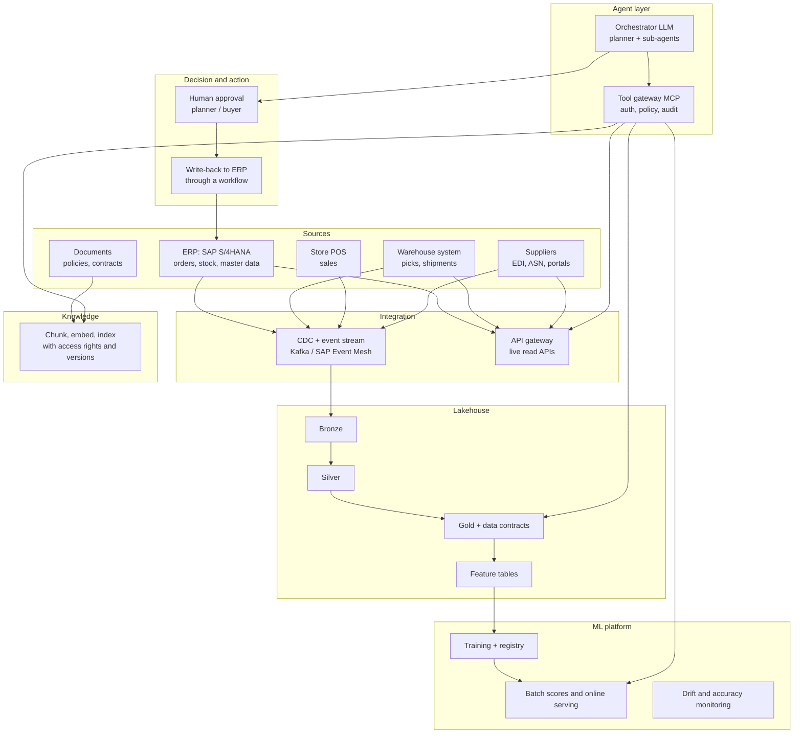

# Reference architecture: a decision agent on a lakehouse

**Contents:** [TL;DR](#tldr) · [The pattern](#the-pattern) · [Big picture](#big-picture) · [Layer by layer](#layer-by-layer) · [One run, end to end](#one-run-end-to-end) · [Design rules](#design-rules) · [Autonomy levels](#autonomy-levels) · [What usually goes wrong](#what-usually-goes-wrong) · [Teams and cost](#teams-and-cost) · [How this project compares](#how-this-project-compares)

Day 0 · Conception · 2026-10-28. Target picture only: nothing in this file is built.
Previous: [benchmark](benchmark.md). Detail: [`cmdb.yml`](../../cmdb.yml) → `conception.reference_architecture`.

## TL;DR

| Question | Answer |
|---|---|
| What is this? | The full enterprise picture of an agent that combines **OLAP + ML + live APIs + RAG + LLM**, using store replenishment as the example |
| The one idea | The LLM computes **no** numbers. It decides which system to ask, combines the answers, explains them and proposes an action |
| Who supplies what? | Lakehouse = trusted history · ML = predictions · live APIs = the current state · RAG = rules and contracts · LLM = reasoning and wording · humans = the decision |
| The big real-life caveat | Retailers already run a **replenishment engine** (SAP F&R, RELEX, Blue Yonder) that computes millions of orders without any LLM. The agent handles **exceptions** and explains them; it does not replace the engine |
| Built here? | Lakehouse, batch ML and the LLM with human approval: yes. Live APIs, RAG and on-demand inference: no ([comparison](#how-this-project-compares)) |

## The pattern

> **TL;DR:** five kinds of evidence, each from the system that owns it; the LLM only puts them together.

| # | Step | Question it answers | System of record | Freshness |
|---|---|---|---|---|
| 1 | **OLAP** | What happened? (sales history, stock history, waste, promotions) | Lakehouse Gold tables | Hours to a day |
| 2 | **ML inference** | What will happen? (demand per store and SKU next week, with an interval) | Model serving, or a forecast table written by a batch job | Up to date with the model and features |
| 3 | **Live API** | What is true right now? (stock on hand, goods in transit, deliveries, supplier capacity) | ERP, warehouse system (WMS), supplier portals, event streams | Seconds to minutes |
| 4 | **RAG** | What are we allowed to do? (replenishment rules, minimum order quantities, contract terms, penalties) | Document store + vector index | Version of the document |
| 5 | **LLM** | So what do we do? (transfer, order, wait), and why | Agent runtime | Per request |

Terms: **OLAP** (online analytical processing) = queries over large history; **SKU** (stock keeping unit) = one product
in one pack size; **RAG** (retrieval-augmented generation) = look up the relevant passages first, then answer from
them with citations.

## Big picture

> **TL;DR:** seven layers; data flows up, actions flow down only through a gateway and a human.

Around all layers: identity, governance, observability, evaluation and cost control ([cross-cutting](#cross-cutting-layers)).

## Layer by layer

> **TL;DR:** each layer has one job, one owner and one interface the agent may use.

### Sources and integration

> **TL;DR:** history arrives by stream or batch into the lakehouse; the current state is read live through an API gateway, never by querying the ERP directly.

| Component | Enterprise practice | Why |
|---|---|---|
| Change data capture (CDC) | Debezium, SAP SLT or Datasphere replication into the lakehouse | History without nightly extracts that load SAP |
| Event stream | Kafka (MSK, Confluent) or SAP Event Mesh: sales, goods receipts, ASNs (advance shipping notices) | Minutes-fresh data for features and alerts |
| Live read APIs | Behind an API gateway (Apigee, Kong, Azure APIM, Amazon API Gateway): quotas, caching, auth | The agent must not overload SAP; every call is logged |
| Supplier data | EDI messages (orders, confirmations, ASNs), supplier portals | Availability and lead times come from the supplier, not a guess |

### Lakehouse (OLAP)

> **TL;DR:** the trusted, reusable history; same as what we built, plus data contracts with every source.

| Component | Practice |
|---|---|
| Bronze → Silver → Gold | Raw, cleaned, business-ready; quality gates between layers |
| Data contracts | Each source team promises a schema, a freshness and an owner; breaking changes fail CI |
| Governance | Unity Catalog (or similar): grants, lineage, tags for personal data, row and column filters |
| Semantic layer | One definition of "stock cover", "waste", "sales" (metric views, dbt metrics) so the agent and Power BI give the same number |
| Agent access | **Certified** views or SQL functions only, never raw tables |

### ML platform

> **TL;DR:** forecasting is mostly batch at scale; on-demand serving is for "what if" and fresh features.

| Component | Practice |
|---|---|
| Feature tables | Sales, promotions, weather, holidays, prices; offline for training, online (low latency) for serving |
| Demand forecast | One model family across stores and SKUs (gradient boosting or a global deep model), with prediction **intervals**, always compared with a naive baseline |
| Registry | MLflow / Unity Catalog models: version, owner, approval, rollback |
| Serving | **Batch:** a nightly forecast for every store and SKU (cheap, most volume). **Online:** an endpoint the agent calls for a scenario ("demand if the promotion runs") |
| Monitoring | Forecast accuracy (MAPE, bias) by store and category, feature drift, alerts to the model owner |

### Live operational APIs

> **TL;DR:** read-only, small, fast, labelled with their timestamp.

| Tool | Returns | Source |
|---|---|---|
| `get_stock_on_hand(store, sku)` | Units, as-of time | ERP or store system |
| `get_in_transit(store, sku)` | Open deliveries, ETA | WMS, ASNs |
| `get_supplier_availability(supplier, sku)` | Confirmed quantity, lead time | Supplier portal or EDI |
| `get_open_orders(store, sku)` | Orders already placed | ERP |

Each answer carries `as_of`; the agent must say how old a figure is.

### Knowledge (RAG)

> **TL;DR:** policies and contracts become searchable passages, filtered by who is asking, cited in every answer.

| Component | Practice |
|---|---|
| Ingestion | Policies, replenishment rules, supplier contracts (PDF, SharePoint, contract management system); one pipeline, versioned |
| Chunking + embeddings | By section, with metadata: supplier, valid from/to, document version |
| Vector index | Databricks Vector Search, Bedrock Knowledge Bases, Vertex AI Search, Azure AI Search |
| Access control | The index applies the same rights as the source: a store manager cannot read contract prices |
| Answers | Must cite document, section and version; "no source found" is a valid answer |
| Structured rules | Hard numbers (minimum order quantity, shelf life, delivery days) belong in **tables**, not only in PDFs; RAG explains them, SQL enforces them |

### Agent layer

> **TL;DR:** an orchestrator plans, sub-agents specialise, every tool call goes through one gateway.

| Component | Practice |
|---|---|
| Orchestrator | A planner LLM that breaks the question down and delegates (e.g. a forecast analyst, a supply checker, a policy reader) |
| Tools | Exposed through **MCP** (Model Context Protocol, a standard way to describe tools to a model) behind a gateway: AgentCore Gateway, Apigee, an internal MCP gateway |
| Gateway | Authenticates the agent **and** the user it acts for, applies policy (which tools, which stores), logs every call |
| Memory | Short-term per conversation; long-term only for approved facts (e.g. "store 214 is closed on Sundays") |
| Guardrails | Input and output filters, PII masking, prompt-injection checks on retrieved documents, a figure check (every number in the answer must come from a tool result) |
| Runtime | Managed agent runtime (AgentCore, Vertex AI Agent Engine, Azure AI Foundry Agent Service) in the same region as the data |

### Decision and action

> **TL;DR:** the agent proposes; a person, or a tight rule, decides; the ERP stays the system of record.

| Step | Practice |
|---|---|
| Proposal | A structured object (store, SKU, quantity, from/to, reason, evidence links), not only text |
| Approval | Sent to the planner or buyer in their tool (Teams, ServiceNow, the replenishment UI) |
| Write-back | Through a business workflow or API that applies the ERP's own checks, never a direct table write |
| Feedback | Accepted, changed or rejected, with the reason, back into the lakehouse to evaluate the agent and retrain |

### Cross-cutting layers

> **TL;DR:** what makes it enterprise: identity, governance, observability, evaluation, cost, operations.

| Concern | Practice |
|---|---|
| Identity | Workload identities, no stored keys; the agent acts **on behalf of** a user and never sees more than that user |
| Governance and compliance | Model and agent inventory, DPIA where people are concerned, EU AI Act risk classification, internal audit trail |
| Observability | Traces of every step: prompt, tool calls, latency, tokens (MLflow tracing, Langfuse, OpenTelemetry) |
| Evaluation | A test set of real past cases with the right answer; run on every prompt, model or tool change; LLM-as-judge plus human review |
| Cost | Token budgets per request, caching, small models for simple sub-tasks, batch where possible |
| Operations | Internal developer platform (golden paths for "new data product", "new agent"), CI/CD for data, models, prompts and tools; on-call and runbooks |

## One run, end to end

> **TL;DR:** a planner's question becomes six tool calls, one recommendation and one approval.

Question from a regional planner: *"Will store 214 run short of fresh milk in the next seven days, and what should we do?"*

| # | Who | Calls | Gets |
|---|---|---|---|
| 1 | Orchestrator | Plans: history, forecast, current stock, supply, rules | A plan |
| 2 | OLAP tool | `sales_history(214, milk, 8 weeks)` | Weekend sales 20% above weekdays; waste low |
| 3 | ML tool | `forecast(214, milk, next 7 days)` | 1,450 units (interval 1,300 to 1,600) |
| 4 | Live API | `get_stock_on_hand`, `get_in_transit` | 380 on hand at 10:05; 600 arriving Friday |
| 5 | Live API | `get_stock_on_hand(nearby stores)`, `get_supplier_availability` | Store 219 has 500 spare; supplier can deliver Saturday, +1 day lead time |
| 6 | RAG tool | `search_policy("transfer fresh dairy")` | Policy v3, §4.2: transfers allowed within 30 km, shelf life ≥ 5 days |
| 7 | Orchestrator | Combines, checks every figure against tool results | Shortfall about 470 units; transfer 300 from 219 + extra order of 200 |
| 8 | Planner | Approves, edits or rejects in Teams | Transfer order created in the ERP through the workflow |

The LLM did no arithmetic on its own: the shortfall comes from a deterministic tool (`compute_gap`) or is checked against
one.

## Design rules

> **TL;DR:** ten rules that separate a demo from a production agent.

1. **Numbers come from tools**, never from the model; a figure check rejects any number not found in a tool result.
2. **Each fact from its owner:** history from Gold, the current state from the live API, rules from the document, predictions from the model.
3. **Show freshness:** every figure carries its `as_of` and source.
4. **Hard rules in code, explanations in RAG:** minimum order quantities are enforced by SQL, not by the model reading a PDF.
5. **Read-only by default;** every write goes through a gateway, a policy and a human (or a strict threshold).
6. **Least privilege on behalf of the user;** the index and the tools apply the user's rights.
7. **Exceptions, not volume:** the replenishment engine handles the routine orders; the agent handles the cases that need judgement.
8. **Evaluate before release** on past cases; no prompt or model change without a passing run.
9. **Trace everything;** an auditor must be able to replay why a recommendation was made.
10. **Same region, same governance** for the model as for the data.

## Autonomy levels

> **TL;DR:** start at "recommend", earn the next level with evidence.

| Level | The agent | Typical use | Needed to get there |
|---|---|---|---|
| 1 · Inform | Answers and explains | Analysts, controllers | Evaluation set, citations |
| 2 · Recommend | Proposes an action with evidence | Planners, buyers | Figure check, structured proposals |
| 3 · Draft | Prepares the transaction; a human clicks approve | Transfers, orders | Write-back workflow, audit trail |
| 4 · Act within limits | Executes below a threshold (e.g. transfers < EUR 500), reports after | High-volume, low-risk cases | Months of level-3 history with a high acceptance rate, business sign-off, kill switch |

Finance postings, payments and anything that changes the ledger stay at level 3 at most (our hard rule 7).

## What usually goes wrong

> **TL;DR:** most failures are data and integration, not the model.

| Failure | Cause | Prevention |
|---|---|---|
| Confident wrong number | The model computed or remembered it | Figure check, tools for every calculation |
| Stale answer | Read stock from yesterday's Gold instead of the live API | Freshness rule, `as_of` shown |
| SAP slowed down | Agent queried the ERP directly in a loop | API gateway with quotas and caching |
| Leaked contract terms | Index ignored document rights | Access filters at query time |
| Prompt injection | A supplier PDF contained instructions | Treat retrieved text as data; output guardrails |
| Nobody uses it | Recommendations arrive outside the planner's tool | Deliver in the existing workflow; capture feedback |
| Token bill grows | Long contexts, big models on simple steps | Budgets, caching, small models for sub-tasks |

## Teams and cost

> **TL;DR:** the same two-team model as here, plus owners for integration and knowledge.

| Team | Owns |
|---|---|
| Supply chain data & AI product team | Gold tables, forecast, tools, agent, evaluation |
| Data & AI platform team | Lakehouse, model serving, vector search, agent runtime, gateway, the developer portal |
| Integration team | CDC, events, API gateway, SAP interfaces |
| Knowledge owners (supply chain, legal, procurement) | The policies and contracts, their versions and rights |
| Business (planners, buyers) | Approvals, feedback, the autonomy level |

Order of magnitude for a large retailer: the forecast and the lakehouse dominate compute; the LLM is usually a small
share as long as the agent handles exceptions (thousands of requests a day), not every order (millions).

## How this project compares

> **TL;DR:** we built the lakehouse, batch ML and a governed LLM with human approval; we did not build live APIs, RAG or on-demand inference.

| Layer | Here | Status |
|---|---|---|
| Lakehouse (OLAP) | Bronze/Silver/Gold, quality gates, certification; agent reads 7 certified SQL functions | ✅ Built (finance data, no inventory) |
| ML inference | Batch: fraud detectors, revenue forecast, drift checks; the agent reads the results | 🟡 Batch only, no serving endpoint |
| Live APIs | None; the gateway carries actions (drafts, approved emails), not live reads | ❌ Not built |
| RAG | None; rules live in SQL and in the agent's instructions | ❌ Not built |
| LLM + agent | Supervisor + 3 sub-agents, figure check, human approval, audit trail | ✅ Built, at autonomy level 3 |
| Cross-cutting | OIDC, least privilege, audit, budgets, PR-only changes | ✅ Built (no developer portal, no evaluation set beyond tests) |

How we would add the missing parts, without changing the agent's design: a live-read Lambda behind the same AgentCore
Gateway; the close policy and accounting manual in Databricks Vector Search, exposed as an MCP tool with citations; the
forecast behind a Databricks serving endpoint. Detail of what was built: [story 7.1](../stories/7.1-month-end-agent.md),
[ADR-006](adr/ADR-006-agent-platform.md).
