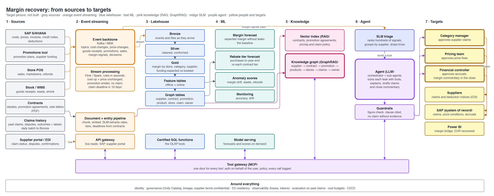
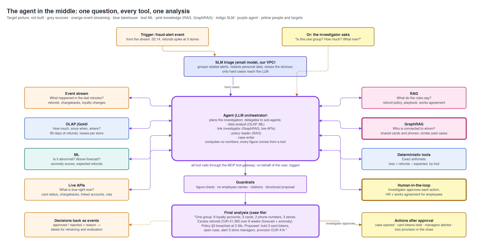

# Reference architecture: a margin recovery agent

**Contents:** [TL;DR](#tldr) · [When is an agent worth it?](#when-is-an-agent-worth-it) · [The question](#the-question) · [Business case](#business-case) · [Build or buy](#build-or-buy) · [Sources and targets](#sources-and-targets) · [Flow: sources to targets](#flow-sources-to-targets) · [The agent in the middle](#the-agent-in-the-middle) · [Layer by layer](#layer-by-layer) · [One run, end to end](#one-run-end-to-end) · [Design rules](#design-rules) · [What usually goes wrong](#what-usually-goes-wrong) · [Teams](#teams) · [How this project compares](#how-this-project-compares) · [Use cases considered](#use-cases-considered)

Day 0 · Conception · 2026-10-28. Target picture only: nothing in this file is built.
Previous: [benchmark](benchmark.md). Français : [reference-architecture.fr.md](reference-architecture.fr.md). Detail: [`cmdb.yml`](../../cmdb.yml) → `conception.reference_architecture`.

## TL;DR

| Question | Answer |
|---|---|
| What is this? | The full enterprise picture of an AI agent that needs **every** tool: event streaming, lakehouse + OLAP, live APIs, ML (forecasts + scores), RAG, GraphRAG, an SLM, humans, and an LLM to tie it together |
| The question | **"Where did we lose margin this month, why, and how much can we still recover before we close the books?"** |
| Who asks | The financial controller and the category managers of our fictional grocer |
| Why an agent | Margin leaks through six systems and hundreds of contracts; each leak needs a different path; no fixed rule or single product sees them all |
| Why build | Margin is the core of a grocer's economics; the data and contracts are ours; the platform is reused by every next use case. **Build the platform, buy the parts** |
| The one idea | The LLM computes **no** numbers and sends **nothing** on its own. It finds, sizes (with tools), explains and drafts; people approve |
| Follows from | Our store margin detector ([story 5.1](../stories/5.1-fraud-detection.md)) and the month-end agent that writes margin commentary ([story 7.1](../stories/7.1-month-end-agent.md)) |

## When is an agent worth it?

> **TL;DR:** six tests; if one fails, something simpler wins.

| # | Test | If it fails, use |
|---|---|---|
| 1 | No fixed rule can decide; it takes judgement | Rules in the ERP or an engine |
| 2 | Evidence is spread across several systems, including text | A SQL query or a BI dashboard |
| 3 | The steps change from case to case | A fixed workflow with one LLM step |
| 4 | Moderate volume (tens to hundreds of cases a day), each worth real money or time | An engine for volume; nothing for low value |
| 5 | A person can check the result, and mistakes can be undone | Keep it human |
| 6 | It is worth building: differentiating, our data, reusable platform; or no product does it whole | Buy |

Gartner's line, as reported: automation for routine workflows, assistants for retrieval, **agents when decisions are
needed**; it also expects over 40% of agentic projects to be cancelled by 2027, mostly for unclear value and cost.

| Test | Margin recovery |
|---|---|
| 1 · Judgement | ✅ Is this leak real, recoverable, worth a supplier conversation? |
| 2 · Many systems + text | ✅ SAP, promotions, POS, stock, supplier portal, contracts |
| 3 · Steps vary | ✅ A pricing error and an unclaimed promotion take different paths |
| 4 · Volume and value | ✅ Tens of cases a day, thousands of euros each |
| 5 · Checkable, reversible | ✅ Every claim, price change and accrual is approved first |
| 6 · Worth building | ✅ See [build or buy](#build-or-buy) |

## The question

> **TL;DR:** one question for the controller, broken into sub-questions; each answered by a different tool.

> **"Where did we lose margin this month, why, and how much can we still recover before we close the books?"**

| Sub-question | Answered by |
|---|---|
| What changed? | **Event streaming**: cost changes, price changes, promotions, goods receipts |
| Which signals deserve a look? | **SLM**: ranks and groups hundreds of signals a day |
| Where, and how much? | **OLAP** on Gold: margin by store, category, supplier, day |
| What should margin have been? | **ML forecast**: expected margin without the leak; purchases to year-end vs rebate tiers |
| What looks abnormal? | **ML scores**: margin drift, waste, refunds |
| What is true right now? | **Live APIs**: current SAP cost and price conditions, claims already sent, credit notes received, open disputes |
| What does the contract say? | **RAG**: the clause, cited ("supplier funds 30% of the promotion discount, claim within 60 days") |
| What belongs together, and who owns it? | **GraphRAG**: supplier → contract → promotion → products → stores → claims → buyer |
| How big is each leak, exactly? | **Deterministic tools**: leak = expected − booked |
| So what do we do? | **LLM**: margin bridge, claim drafts, price-fix list, close commentary |
| Who decides? | **Humans**: category manager (claims), pricing team (prices), controller (accruals) |

## Business case

> **TL;DR:** in grocery a few tenths of a margin point is the whole profit; it leaks through holes that no single system or team sees.

| Question | Answer |
|---|---|
| Problem | Net margin in grocery is about 1–3% of sales. Margin leaks through many small holes, each owned by a different system and team |
| How it is handled today | Monthly margin reviews in spreadsheets; buyers chase funding when they remember; recovery-audit firms find unclaimed money **months later** and keep a share; small items are written off |
| What the agent does | Watches the events, finds and sizes each leak, links it to the contract and the owner, drafts the claim or the fix, and writes the margin commentary for the close |
| Who decides | Category manager, pricing team, financial controller. Nothing goes to a supplier or the ledger automatically |
| Measured by | EUR recovered within the month, claims sent before their deadline, margin explained in the close (share of the gap with a named cause), analyst hours saved |
| Not the goal | Negotiating with suppliers or changing prices without a person |

### The leaks

| Leak | Example | Recoverable? | Owned by |
|---|---|---|---|
| Promotion funding not claimed | The promotion ran; the supplier's agreed contribution was never invoiced | Yes, before the claim deadline | Category manager |
| Cost up, price unchanged | Supplier raised cost on the 3rd; shelf price never updated | Partly, from today on | Pricing |
| Rebate tier at risk | EUR 80k short of the next tier with two months left | Yes, by shifting purchases | Category manager |
| Supplier deductions not taken or not defended | A late or short delivery we were entitled to charge; a supplier disputes our deduction and we can't find the proof | Yes, with evidence | Accounts payable |
| Shrink and waste | Fresh waste doubled in 12 stores | No; send to store operations | Store operations |
| Fraud | Refund pattern at two tills | Partly; send to loss prevention | Loss prevention |
| Excess markdowns | Clearance discounts started too early | No; learn for next time | Pricing |

## Build or buy

> **TL;DR:** build the platform and the agent where the question is ours; buy the commodity parts.

| Criterion | Margin recovery |
|---|---|
| Differentiating? | Yes: margin is the grocer's economics; knowing why it moved, early, is an advantage |
| Cross-silo? | Six systems plus contracts; vendors each cover one silo (pricing, rebates, deductions, loss prevention) |
| Our data? | Contracts, promotions, costs and prices are confidential and specific to us |
| Platform reuse? | Same lakehouse, gateway, agent runtime and controls as the close agent; the next use case costs little |
| Control? | EU residency, audit trail, our guardrails, no supplier terms in a vendor's cloud |
| Cost model? | Recovery-audit firms take a share of what they find; per-seat AI pricing grows with users |
| **Buy** | Models (LLM, SLM), the streaming service, vector and graph stores, OCR, the agent runtime |
| **Build** | Gold, graph tables, tools, the agent's logic, evaluation, the guardrails |

## Sources and targets

> **TL;DR:** seven sources in, six targets out; events flow both ways.

### Sources

| Source | Gives | How it arrives | Freshness |
|---|---|---|---|
| SAP S/4HANA | Costs, prices, purchase orders, invoices, credit notes, deductions | CDC events; live reads through the API gateway | Seconds |
| Promotions tool | Promotion plans, dates, agreed supplier funding | Events | Minutes |
| Store POS | Sales, markdowns, refunds | Events | Seconds |
| Stock / WMS | Goods receipts, waste, shrink | Events | Minutes |
| Contracts | Rebate agreements, promotion agreements, side letters (PDF) | Document + entity pipeline | When a version is signed |
| Claims history | Past claims, disputes and outcomes: the **labels** | Daily batch | Daily |
| Supplier portal / EDI | Claim status, disputes, confirmations | Live API; EDI messages as events | Minutes |

### Targets

| Target | Receives | After |
|---|---|---|
| **Category manager** | Claim drafts with clause and evidence; rebate tiers at risk | The agent |
| **Pricing team** | Price-fix list (cost up, price unchanged) | The agent |
| **Financial controller** | Accrual proposals; margin bridge and commentary for the close | The agent |
| **Suppliers** | Claims and deduction notices by EDI or portal | Category manager approval |
| **SAP** (system of record) | Claim documents, price conditions, accrual postings, through workflows with SAP's own checks | Approval |
| **Power BI** | Margin bridge, EUR recovered, claims by status | Reads Gold |
| **Event backbone** (back in) | Approved, rejected, paid, with the reason | Every decision; becomes the next label |

## Flow: sources to targets

> **TL;DR:** data flows left to right through streaming, lakehouse, ML and knowledge; every tool call passes one gateway.

| Column | Holds |
|---|---|
| 1 · Sources | The seven systems above |
| 2 · Event streaming | Event backbone, stream processing (the margin-signal rules), document + entity pipeline, API gateway |
| 3 · Lakehouse | Bronze → Silver → Gold, feature tables, graph tables, certified SQL functions |
| 4 · ML | Margin forecast, rebate tier forecast, anomaly scores, monitoring, serving |
| 5 · Knowledge | Vector index (RAG), knowledge graph (GraphRAG) |
| 6 · Agent | SLM triage, LLM agent, guardrails |
| 7 · Targets | Three approvers first, then the systems that act |

Source: [reference-architecture-flow.drawio](reference-architecture-flow.drawio).

## The agent in the middle

> **TL;DR:** one trigger, nine kinds of evidence, one margin bridge, three human decisions.

The agent plans, then delegates to sub-agents: a **margin analyst** (OLAP, ML), a **contract reader** (RAG,
GraphRAG), an **evidence collector** (live APIs) and a **claim and commentary writer**. Source:
[reference-architecture-agent.drawio](reference-architecture-agent.drawio).

**When it runs:** on margin-signal events that pass SLM triage; every day of close week; or when the controller asks.
Never once per sale or per price change: the stream rules and the SLM filter first.

## Layer by layer

> **TL;DR:** each layer has one job, one owner and one interface the agent may use.

### Event streaming

> **TL;DR:** margin moves when a cost, a price or a promotion changes; the stream sees it the same day, not at month-end.

| Component | Practice |
|---|---|
| Event backbone | Kafka (Amazon MSK, Confluent) or SAP Event Mesh; topics `cost-changes`, `price-changes`, `goods-receipts`, `promotions`, `sales`, `margin-signals`, `decisions` |
| CDC from SAP | SAP SLT, Datasphere replication or Debezium; condition and invoice changes become events |
| Schema registry | Versioned schema per topic; breaking changes rejected (the data contract of the stream) |
| Stream processing | Flink or Spark Structured Streaming. Rules: cost up and price unchanged after 2 days; promotion ended and no claim after 7 days; claim deadline in 10 days; publish to `margin-signals` |
| Into the lakehouse | Streaming ingest into Bronze; streaming tables where freshness matters |
| Back out | Decisions on `decisions`: audit, evaluation, labels |

### Lakehouse and OLAP

> **TL;DR:** the trusted margin history and the links the graph needs.

| Component | Practice |
|---|---|
| Bronze → Silver → Gold | Quality gates; margin by store, category, supplier, day; funding **expected** (from agreements) vs **booked** (from SAP) |
| Graph tables | Nodes: supplier, contract, clause, promotion, product, store, claim, buyer. Edges: funds, covers, sold at, claimed by, owned by |
| Certified SQL functions | The OLAP tools the agent may call |
| Governance | Unity Catalog grants and lineage; supplier terms readable only by finance and buying roles |

### ML: forecasts and scores

> **TL;DR:** the forecast says what margin should have been; the scores say where it looks wrong.

| Model | Practice |
|---|---|
| Margin forecast | Expected margin by category and store (mix, promotions, seasonality); the gap to actual is what the agent explains; must beat a naive baseline |
| Rebate tier forecast | Purchases to year-end per supplier vs each contract tier, with an interval |
| Anomaly scores | Margin drift, waste, refunds per store (our story 5.1 detector, extended) |
| Labels | Past claims and outcomes (paid, rejected, why) from claims history and the `decisions` topic |
| Monitoring | Forecast accuracy, score precision, drift |

### Live APIs

> **TL;DR:** before anything goes to a supplier, check SAP and the portal right now.

| Tool | Returns |
|---|---|
| `get_conditions(supplier, sku)` | Current cost and price in SAP, valid from |
| `get_claims(supplier, period)` | Claims already sent, their status |
| `get_credit_notes(supplier, period)` | Money already received |
| `get_disputes(supplier)` | Open disputes on the supplier portal |

All behind an API gateway with quotas and caching; every answer carries `as_of`.

### SLM

> **TL;DR:** a small language model does the volume work cheaply and inside our network.

| Use | Why an SLM |
|---|---|
| Rank and group hundreds of margin signals a day | An LLM call per signal costs too much |
| Extract rates, tiers, exclusions and deadlines from thousands of contracts | A narrow task, fine-tuned once, reviewed by a person |
| Keep supplier terms inside the VPC for these steps | Confidential data stays with us |
| Examples | Llama 3.2 3B, Phi, Gemma, Mistral Small; on our own GPU or a private endpoint |

### RAG

> **TL;DR:** the exact clause, cited, readable only by those allowed.

| Component | Practice |
|---|---|
| Content | Rebate and promotion agreements, side letters, pricing policy, claim policy |
| Index | Databricks Vector Search, Bedrock Knowledge Bases or Azure AI Search; chunks with supplier, version, valid from/to |
| Rights | The source's access rights applied at query time |
| Answers | Document, section and version cited; "no clause found" means no claim |

### GraphRAG

> **TL;DR:** RAG finds the clause; GraphRAG finds what belongs together and who owns it.

| Component | Practice |
|---|---|
| What it is | Retrieval over a knowledge graph: entities, their links, and LLM-written summaries of each group, instead of only text chunks |
| Graph | Graph tables (structured links) plus entities the SLM extracts from contracts |
| Store | Neo4j, Amazon Neptune, or graph tables in the lakehouse |
| Queries | "Which ended promotions of this supplier have no claim, under which agreement, owned by whom?"; "Which other suppliers have the same unclaimed pattern?" |
| Why not plain RAG | Plain RAG returns similar text; it can't follow promotion → agreement → clause → products → claims |

### LLM agent

> **TL;DR:** plans, calls tools, links evidence, writes; never calculates, never sends.

| Component | Practice |
|---|---|
| Triggers | Margin-signal events after SLM triage; close-week daily run; the controller's question |
| Orchestrator | Plans and delegates to sub-agents (margin analyst, contract reader, evidence collector, writer) |
| Tools | Via **MCP** (Model Context Protocol) behind one gateway: auth on behalf of the user, policy per tool, every call logged |
| Guardrails | Figure check (every number from a tool), a clause cited for every claim, no claim without evidence, prompt-injection filter on documents |
| Runtime | AgentCore, Vertex AI Agent Engine or Azure AI Foundry, in the EU |

### Humans

> **TL;DR:** three owners, three kinds of decision.

| Action | Who decides |
|---|---|
| Send a claim to a supplier | Category manager |
| Change a price | Pricing team |
| Book an accrual; publish the margin commentary | Financial controller |
| Later, possibly automatic | Claims under a small threshold with a cited clause and a high past acceptance rate, after months of evidence (autonomy level 4) |

### Cross-cutting

> **TL;DR:** identity, confidentiality, observability, evaluation, cost.

| Concern | Practice |
|---|---|
| Confidentiality | Supplier terms restricted to finance and buying; EU residency |
| Identity | Workload identities, no stored keys; tools run on behalf of the user |
| Observability | Traces of every step (prompt, tool calls, tokens); stream lag; model drift |
| Evaluation | Past months with known claims and outcomes; run on every prompt, model or tool change |
| Cost | SLM for volume, LLM for real cases; token budgets |
| Audit | Every claim traceable to events, tables, clause and approver |

## One run, end to end

> **TL;DR:** close week, day 2: the controller asks; 20 minutes later a margin bridge with EUR 1.2M recoverable.

Monthly sales EUR 950M; margin 0.2 points below forecast.

| # | Who | Does | Gets |
|---|---|---|---|
| 1 | Controller | Asks the question in Teams | A case |
| 2 | SLM | Pulls this month's 312 margin signals, groups them by supplier | 23 real cases |
| 3 | OLAP | `margin_by_category_supplier(month)` | Gap concentrated in dairy, drinks, fresh |
| 4 | ML forecast | `expected_margin(month)` | Gap **EUR 1.9M** vs forecast (computed by a tool) |
| 5 | GraphRAG | `unclaimed_promotions(month)` | 14 ended promotions, 5 suppliers, no claim; owners named |
| 6 | RAG | `contract_clause(supplier, promotion)` | Funding rates and claim deadlines, cited |
| 7 | Live APIs | `get_claims`, `get_credit_notes`, `get_conditions` | No claims sent; 140 SKUs with cost +6% since the 3rd and shelf price unchanged |
| 8 | ML + tools | Rebate tier forecast; `leak_size` for each case | Promotion funding EUR 610k, cost not passed on EUR 380k, rebate tier at risk EUR 210k; waste EUR 700k not recoverable |
| 9 | LLM | Margin bridge, 5 claim drafts, price-fix list, commentary; guardrails check every figure and clause | Final analysis |
| 10 | Humans | Category managers approve 5 claims; pricing fixes 140 prices; controller books accruals | Claims sent, prices fixed, commentary in the close pack; `decisions` events published |

610 + 380 + 210 = EUR 1.2M recoverable; with waste, EUR 1.9M explained. Without the agent, part of the EUR 610k would
come back next year through a recovery audit, minus its fee, and some claims would pass their deadline.

## Design rules

> **TL;DR:** ten rules that separate a demo from a production agent.

1. **Numbers come from tools**, never from the model; a figure check enforces it.
2. **No clause, no claim:** every claim cites its contract clause and its evidence.
3. **Each fact from its owner:** history from Gold, now from SAP, terms from the contract, links from the graph, "expected" from the forecast.
4. **Show freshness and sources:** every figure carries its `as_of` and origin.
5. **SLM for volume, LLM for judgement.**
6. **Hard rules in code, explanations in RAG:** claim deadlines and rates live in tables once extracted; the PDF is the proof.
7. **Read-only by default;** every write through the gateway, a workflow and a person.
8. **Event-driven:** signals start the work; nothing polls SAP.
9. **Evaluate before release** on past months with known outcomes.
10. **Trace everything,** so an auditor or a supplier dispute can replay why a claim was sent.

## What usually goes wrong

> **TL;DR:** most failures are data and process, not the model.

| Failure | Cause | Prevention |
|---|---|---|
| Wrong claim sent | Clause misread or an old contract version | Clause cited with version; category manager approves |
| Wrong amount | Model did the arithmetic | Deterministic tool, figure check |
| Claim sent twice | Didn't check SAP right now | Live API check before every draft |
| Signal flood | A general price increase raises thousands of signals | Stream rules grouped by supplier; SLM triage |
| Contract terms leak | Index ignores rights | Access filters at query time; EU residency |
| Supplier relationship damaged | Too many small claims | Thresholds per supplier, set by category managers |
| Labels never improve | Outcomes not captured | `decisions` topic; paid / rejected recorded |

## Teams

> **TL;DR:** the same two-team model as in this project, plus the business owners.

| Team | Owns |
|---|---|
| Finance data & AI product team | Gold, graph tables, forecasts, tools, agent, evaluation |
| Data & AI platform team | Lakehouse, event backbone, serving, vector and graph stores, SLM hosting, agent runtime, gateway |
| Integration team | SAP CDC, promotions tool, supplier portal and EDI |
| Buying (category managers) | Claims, supplier relationships, thresholds |
| Pricing | Price fixes |
| Finance (controller, accounts payable) | Accruals, commentary, deductions |

## How this project compares

> **TL;DR:** we built the lakehouse, a margin detector, a forecast and a governed agent that writes margin commentary; not streaming, live APIs, RAG, GraphRAG or the SLM.

| Layer | Here | Status |
|---|---|---|
| Lakehouse + OLAP | Bronze/Silver/Gold, quality gates, certification; agent reads certified SQL functions incl. `store_margin_alerts` | ✅ Built |
| ML: scores | Isolation Forest detectors: store margin drift and cashier refunds, monthly | 🟡 Built, batch |
| ML: forecast | Revenue forecast that must beat a baseline | 🟡 Built, revenue not margin |
| Event streaming | Daily files with Auto Loader | ❌ Not built |
| Live APIs | None; the gateway carries actions (drafts, approved emails) | ❌ Not built |
| RAG / GraphRAG | None; no contracts in the data | ❌ Not built |
| SLM | None; one LLM (Gemini) does everything | ❌ Not built |
| LLM agent | Supervisor + 3 sub-agents, figure check, margin commentary in the close | ✅ Built |
| Humans | Controller approves each draft | ✅ Built |

Built detail: [story 5.1](../stories/5.1-fraud-detection.md), [story 7.1](../stories/7.1-month-end-agent.md),
[ADR-006](adr/ADR-006-agent-platform.md).

## Use cases considered

> **TL;DR:** three candidates were dropped, each for a clear reason.

| Candidate | Why dropped |
|---|---|
| Store replenishment ("transfer or order?") | A replenishment engine (SAP F&R, RELEX) already places the orders without an LLM; an agent would only handle exceptions |
| Refund fraud rings | Fits all the tools, but specialist products (e.g. Appriss Retail) already link cases with graphs and LLMs; a weaker build case |
| Vendor chargeback disputes | A real problem, but for **suppliers** fighting retailer deductions. For a retailer it is one leak among others (deductions not taken or not defended), now part of this use case |
