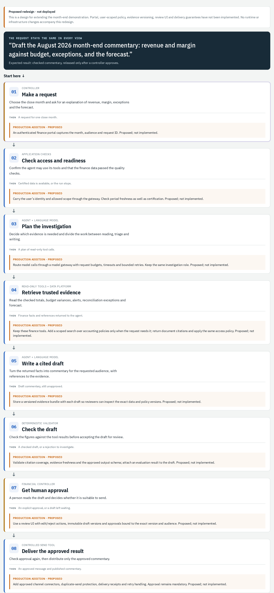

# Reference architecture: production month-end close

**Contents:** [TL;DR](#tldr) · [The same request](#the-same-request) · [What production adds](#what-production-adds) · [Before and around the request](#before-and-around-the-request) · [Implementation boundary](#implementation-boundary) · [Other use cases](#other-use-cases)

Redesigned 2026-11-13. This is a proposal, not deployed functionality. Demonstrated implementation: [HLD](../architecture/hld.md).
Detail: `cmdb.yml` → `architecture.request_journey`, `conception.reference_architecture`; story [X.3](../stories/X.3-request-journey.md).

## TL;DR

| Question | Answer |
|---|---|
| What does this extend? | The demonstrated month-end commentary agent |
| What stays the same? | Question, eight stages, reading direction, trusted finance tools and human approval |
| What changes? | Production access, bounded model calls, evidence versions, review UI, reliable delivery and monitoring |
| Implemented? | No. This redesign changes site and docs only |
| Margin recovery? | A [separate possible use case](margin-recovery.md), not the enterprise version of month-end close |

## The same request

> **TL;DR:** start with the same controller, month and expected result as the demonstration.

“Draft the August 2026 month-end commentary: revenue and margin against budget, exceptions, and the forecast.”

Read down from 1 to 8. Simple and Expert retain the same stages; Expert opens the proposed component hand-offs.
The model can iterate on evidence and writing inside that lifecycle. Approval remains mandatory before any send.

## What production adds

> **TL;DR:** extend each existing stage rather than replace the use case.

| # | Existing capability | Proposed production addition — not implemented |
|---|---|---|
| 1 · Request | Controller starts a close-month run | Finance portal, company sign-in, audience and request ID |
| 2 · Check | Agent grants and Gold certification | User-scoped tool policy, freshness and allowed-period checks |
| 3 · Plan | Supervisor, Gemini EU, three sub-agents | Model gateway, approved EU models, request budgets and bounded retries |
| 4 · Evidence | Seven functions including certification; prepared Gold and ML results | Keep finance tools; add scoped accounting-policy search only where needed |
| 5 · Draft | Cited draft per audience | Versioned data and document evidence bundle |
| 6 · Validate | Deterministic figure check outside the model | Citation coverage, freshness, output schema and evaluation record |
| 7 · Approve | Controller writes an approval row | Review UI, edit/reject actions and approval bound to exact draft version and audience |
| 8 · Deliver | Approval check, SES and commentary table | Approved channel connectors, duplicate protection, delivery receipts and retries |

The production diagram is a proposed design. It does not claim those additions are present in the agent code,
Terraform, data jobs or cloud estate. Figure validation checks grounding; it does not prove the explanation is correct.

## Before and around the request

> **TL;DR:** improve the data and controls without adding them as detours in the request chart.

| Area | Proposed change |
|---|---|
| Preparation | Replace synthetic sources with approved ingestion, contracts and freshness gates; retain Bronze → Silver → certified Gold → ML |
| Identity | Supported federation instead of manual Databricks secret rotation; carry caller scope |
| Connectivity | Approved EU hosting and private connectivity where supported; no assertion that the agent has moved clouds |
| Monitoring | One trace per request, model/tool cost, failure alerts with owners, evaluations on versioned golden cases |
| Operations | Controlled releases and rollback, scoped request budgets and operational ownership |

Budgets are not a guarantee of a cloud billing ceiling. Production controls require implementation and independent verification.
Evaluation guidance: [evaluation and observability](evaluation-observability.md).

## Implementation boundary

> **TL;DR:** the as-built demonstration remains the reference for what actually happened.

No runtime feature was added by this redesign. The platform is paused; paid interface endpoints were deleted on
2026-10-17. Restoring them requires owner approval. Teams, ServiceNow, Power BI and the CFO pack remain planned or simulated
integrations. The controller review UI, evidence versioning and delivery guarantees above have not been built.

## Other use cases

> **TL;DR:** margin recovery reuses platform capabilities but answers a different question.

The earlier [margin recovery design](margin-recovery.md) explores supplier funding, pricing and contracts.
Streaming, GraphRAG and live supplier APIs belong to that separate extension when justified by its requirements;
they are not mandatory additions to the month-end commentary journey.
